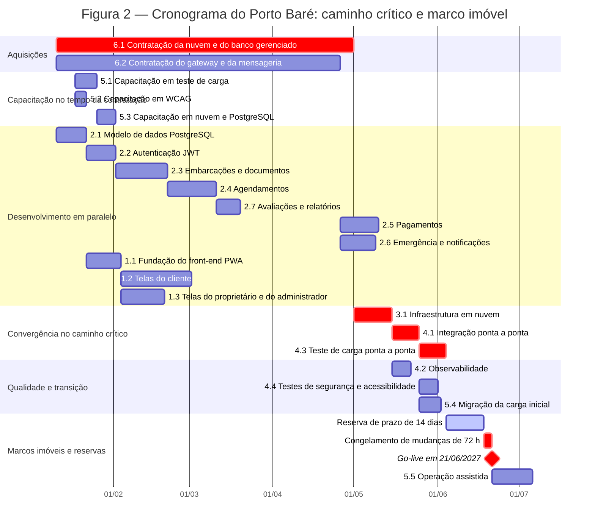

# Porto Baré — Etapa 2: Do projeto ao plano de projeto

| Campo | Informação |
|---|---|
| **Instituição** | Centro Universitário de Ensino Superior do Amazonas (CIESA) |
| **Curso** | Análise e Desenvolvimento de Sistemas (ADS) |
| **Disciplina** | Projetos de Sistemas |
| **Trabalho** | Etapa 2: plano de projeto a partir da arquitetura da Etapa 1 (entrega individual) |
| **Aluno** | José Lima da Mota Neto |
| **Sistema** | Porto Baré — consulta e agendamento de embarcações |
| **Base** | Arquitetura cliente-servidor da Etapa 1, em [`README.md`](README.md) |
| **Versão** | 1.0 — novembro de 2026 |

Este documento converte a arquitetura da Etapa 1 em um plano de projeto, segundo os domínios do PMBOK. **Regra central:** cada pacote, prazo e custo abaixo nasce de uma decisão de arquitetura da Etapa 1, e o que não nasce dela não entra no plano. Toda estimativa de custo e de prazo traz a premissa que a sustenta (seção 0.2).

---

## Sumário

- [0. Ponto de partida](#0-ponto-de-partida)
- [1. Tabela de impacto: seis ângulos da mesma decisão](#1-tabela-de-impacto-seis-ângulos-da-mesma-decisão)
- [2. Entregáveis da Etapa 2](#2-entregáveis-da-etapa-2)
  - [2.1 Escopo: a EAP](#21-escopo-a-eap)
  - [2.2 Cronograma e caminho crítico](#22-cronograma-e-caminho-crítico)
  - [2.3 Custo em três anos](#23-custo-em-três-anos)
  - [2.4 Estimativa dos pacotes (PERT)](#24-estimativa-dos-pacotes-pert)
  - [2.5 Riscos](#25-riscos)
  - [2.6 Aquisições](#26-aquisições)
  - [2.7 Recursos humanos](#27-recursos-humanos)
- [3. Rastreabilidade e conformidade](#3-rastreabilidade-e-conformidade)

---

## 0. Ponto de partida

### 0.1 Decisões de arquitetura de origem

Estas são as decisões da Etapa 1 que o plano precisa pagar. D1 a D3 são os três ADRs. D4 e D5 não têm ADR próprio, mas aparecem como elementos do C4 (que a seção 2.4 da Etapa 1 já aceita como decisão).

| Código | Decisão | Fonte na Etapa 1 | Requisitos que a motivam |
|---|---|---|---|
| D1 | Aplicação web responsiva (PWA) como cliente, em vez de aplicativo nativo | ADR-001 | RNF03, RNF07, RNF08, RNF11, RF19 |
| D2 | PostgreSQL (relacional) como banco de dados principal | ADR-002 | RF04, RF10, RN02, RNF01, RNF02, RNF09 |
| D3 | Autenticação por token JWT de curta duração | ADR-003 | RNF04, RNF05, RNF06, RF01, RF22 |
| D4 | Hospedagem em nuvem, com a API em ao menos 2 instâncias e armazenamento de arquivos criptografado | C4 nível 2 (Figura 2) | RNF06, RNF12 |
| D5 | Gateway de pagamento e serviço de mensageria externos | C4 nível 1 (Figura 1) e nível 2 (Figura 2) | RF05, RF23, RF19, RNF10 |

### 0.2 Premissas gerais

Número sem premissa não é estimativa, é chute. Todas as premissas abaixo são do autor, para fins do exercício, e os valores em reais são preços de referência hipotéticos a confirmar por cotação.

| Código | Premissa |
|---|---|
| P1 | O projeto começa em **11/01/2027**. Todas as durações são em **dias corridos** (já contam fins de semana e feriados) e, no cronograma, cada pacote usa o PERT arredondado para dia inteiro. |
| P2 | **Marco imóvel:** lançamento (go-live) em **21/06/2027**, para pegar a alta temporada de passeios de junho e julho. Há **congelamento de mudanças de 72 h** antes (18 a 21/06). |
| P3 | Equipe de implantação em tempo equivalente (FTE) e custo mensal total por pessoa (salário, encargos e benefícios): gerente de projeto 0,5 (R$ 18.000), arquiteto e tech lead 1,0 (R$ 20.000), desenvolvedor back-end 1,0 (R$ 14.000), desenvolvedor front-end 1,0 (R$ 13.000), DevOps e DBA 0,5 (R$ 17.000), QA 0,5 (R$ 10.000) e UX e acessibilidade 0,25 (R$ 12.000). Total: **R$ 72.500 por mês**. |
| P4 | A equipe atua por **5,8 meses**: 161 dias até o go-live mais 15 dias de operação assistida (176 dias). |
| P5 | O Porto Baré é mantido por entidade pública de turismo e fomento, então as contratações de maior valor seguem a **Lei 14.133/2021**, com prazo mínimo prático de **90 dias**. Se fosse operação privada, o prazo cairia para cerca de 20 a 30 dias. |
| P6 | Cursos abertos têm inscrição direta, em cerca de 7 dias, então as capacitações começam no dia 7. |
| P7 | **Limites da frente:** R$ 800.000 de investimento e R$ 400.000 por ano de custeio. O custeio pode ser **contingenciado em até 10% sem aviso**, ou seja, o teto efetivo cai para R$ 360.000 por ano. |
| P8 | Dimensionamento: 500 usuários simultâneos (RNF01) e cerca de 3.000 agendamentos por mês. |
| P9 | A taxa do gateway é cobrada por transação e repassada ao cliente (campo `taxa_servico` da Etapa 1), ficando fora do custeio. |
| P10 | Não há sistema anterior. Os dados de embarcações, proprietários e documentos estão hoje em planilhas e papel, então a "migração" é uma **carga inicial** dos dados. |
| P11 | Diária de referência de desenvolvedor: **R$ 650** (R$ 14.000 por mês dividido por cerca de 21,5 dias úteis). |
| P12 | Probabilidades e impactos de risco são julgamento do autor, que tomam o lugar de dados históricos que o projeto ainda não tem. |

---

## 1. Tabela de impacto: seis ângulos da mesma decisão

Cada decisão responde às seis perguntas do enunciado. Os números detalhados estão nas seções 2.1 a 2.7.

### D1 — Aplicação web responsiva (PWA), ADR-001

| Dimensão | Resposta |
|---|---|
| Escopo | **Cria** 1.1, 1.2, 1.3 (um único front-end para os três perfis) e 5.2 (capacitação em acessibilidade). **Elimina** E2: aplicativos nativos Android e iOS com publicação em lojas. |
| Cronograma | 1.1 depende de 5.2. As telas 1.2 e 1.3 andam em paralelo ao back-end, pelo contrato REST da Etapa 1 (seção 2.3.2). Fora do caminho crítico (folga de 88 dias em 1.2). |
| Custo | Implantação: front-end 1,0 e UX 0,25 dentro da equipe (P3), mais R$ 5.400 de capacitação. Evita cerca de R$ 108.000 de apps nativos. Operação: uma única base de código. |
| Riscos | **Mitiga:** código duplicado e atualização lenta. **Cria:** R6 (alerta de emergência sem sinal em trecho de rio) e R7 (telas fora do WCAG). |
| Aquisições | **Construir.** O front-end é o diferencial do negócio. Sem fornecedor além de bibliotecas open source. |
| Equipe | A competência em WCAG 2.1 AA não existe, então vira o pacote 5.2. Opera depois: dev de sustentação (telas) e analista de operações (conteúdo e suporte). |

### D2 — PostgreSQL (relacional), ADR-002

| Dimensão | Resposta |
|---|---|
| Escopo | **Cria** 2.1, 2.3, 2.4, 2.7 e 5.4 (carga inicial no esquema relacional). **Elimina** E4: lógica de aplicação para impedir agendamentos sobrepostos, que passa a ser uma restrição do banco. |
| Cronograma | 2.1 abre a cadeia 2.1 → 2.2 → 2.3 → 2.4. A carga inicial (5.4) só roda depois da integração (4.1). A cadeia tem 65 dias de folga: não é crítica. |
| Custo | Implantação: tech lead e back-end dentro da equipe. Operação: banco gerenciado dentro dos R$ 6.500 por mês de nuvem, mais 0,3 de DevOps e DBA. |
| Riscos | **Mitiga:** venda dupla do mesmo horário. **Cria:** R3 (atributos por tipo de embarcação) e R4 (concorrência sob carga). |
| Aquisições | **Comprar como serviço gerenciado.** PostgreSQL é open source e portável, então a dependência do fornecedor é baixa. |
| Equipe | Competência parcial em restrições de exclusão e em operar PostgreSQL gerenciado, coberta por 5.3. Opera depois: DevOps e DBA de plantão. |

### D3 — Autenticação por JWT, ADR-003

| Dimensão | Resposta |
|---|---|
| Escopo | **Cria** 2.2 e parte de 4.4 (testes de revogação e de TLS). **Elimina** E3: armazenamento compartilhado de sessões. |
| Cronograma | 2.2 depende de 2.1 e precede 2.3, porque toda rota protegida exige token. Folga de 65 dias. |
| Custo | Implantação: 11 dias do back-end, dentro da equipe. Operação: nenhum componente extra, o que evita cerca de R$ 13.200 por ano. |
| Riscos | **Mitiga:** ponto único de falha das sessões (RNF06). **Cria:** R5 (usuário suspenso consegue renovar o token). |
| Aquisições | **Construir** com biblioteca open source de JWT. Sem fornecedor. |
| Equipe | A competência existe no back-end. A verificação independente vem da auditoria de segurança em 4.4. Opera depois: dev de sustentação. |

### D4 — Hospedagem em nuvem com 2 ou mais instâncias e armazenamento criptografado, C4 nível 2

| Dimensão | Resposta |
|---|---|
| Escopo | **Cria** 3.1, 4.2, 4.3, 5.1, 5.3, 5.5 e 6.1. **Elimina** E1: compra, instalação e sala técnica de servidores próprios. |
| Cronograma | 6.1 (mínimo de 90 dias) → 3.1 → 4.1 → 4.3 é o **caminho crítico**. As capacitações 5.1 e 5.3 usam o tempo morto da contratação. |
| Custo | Implantação de R$ 584.070 (nuvem) contra R$ 908.520 (servidores próprios). Operação de R$ 358.800 por ano contra R$ 450.000. Ver seção 2.3. |
| Riscos | **Mitiga:** R10 (indisponibilidade na alta temporada), pela segunda instância. **Cria:** R1 (contratação atrasa), R11 (equipe sem experiência em nuvem) e R12 (custeio contingenciado). |
| Aquisições | **Comprar** (lote 1). A dependência do fornecedor é média a alta, reduzida por PostgreSQL, API S3 e containers padrão. Sair custa cerca de 90 dias e R$ 39.000 (seção 2.6). |
| Equipe | A competência em nuvem e em teste de carga não existe, então vira os pacotes 5.1 e 5.3. Opera depois: DevOps e DBA de plantão. |

### D5 — Gateway de pagamento e mensageria externos, C4 níveis 1 e 2

| Dimensão | Resposta |
|---|---|
| Escopo | **Cria** 2.5, 2.6 e 6.2. **Elimina** E5: processar cartões e manter servidor próprio de e-mail e SMS. |
| Cronograma | 6.2 (mínimo de 90 dias) → 2.5 e 2.6. É uma cadeia **quase crítica**, com 19 dias de folga contra 14 do caminho crítico. |
| Custo | Implantação dentro da equipe, sem licença. Operação: R$ 9.600 por ano de mensageria. A taxa do gateway é repassada (P9). |
| Riscos | **Mitiga:** guarda de dados de cartão (o sistema nunca os armazena). **Cria:** R9 (credenciais e homologação atrasam). |
| Aquisições | **Comprar** (lote 2). Dependência média, isolada no adaptador do módulo Pagamentos. Sair custa cerca de 90 dias e R$ 15.600. |
| Equipe | A equipe domina APIs REST, e a homologação com o gateway é nova (apoio do fornecedor). Opera depois: analista de operações (conciliação) e dev de sustentação. |

---

## 2. Entregáveis da Etapa 2

### 2.1 Escopo: a EAP

A EAP é a arquitetura decomposta em pacotes de trabalho, em quatro níveis: raiz, frente (1 a 7), pacote (1.1) e atividade (1.1.1). Inclui os **pacotes de transição** (capacitação, observabilidade e migração) e os **pacotes que a arquitetura elimina**.

#### Pacotes criados e eliminados

| Decisão | Pacotes que a decisão cria | Pacotes que a decisão elimina |
|---|---|---|
| D1 (PWA) | 1.1, 1.2, 1.3 e a capacitação 5.2 | **E2** Aplicativos nativos Android e iOS e publicação em lojas (cerca de R$ 108.000: 2 desenvolvedores × 4 meses × R$ 13.500, P3) |
| D2 (PostgreSQL) | 2.1, 2.3, 2.4, 2.7 e a carga inicial 5.4 | **E4** Lógica de aplicação contra sobreposição de horários (cerca de 10 dias de desenvolvimento e testes, P11) |
| D3 (JWT) | 2.2 e parte de 4.4 | **E3** Armazenamento compartilhado de sessões (8 dias de desenvolvimento e cerca de R$ 13.200 por ano, R$ 1.100 por mês) |
| D4 (nuvem) | 3.1, 4.2, 4.3, 5.1, 5.3, 5.5 e 6.1 | **E1** Compra, instalação e sala técnica de servidores próprios (R$ 320.000, 45 dias de entrega e instalação após a licitação de 90 dias, e R$ 91.200 por ano a mais de operação) |
| D5 (gateway e mensageria) | 2.5, 2.6 e 6.2 | **E5** Processamento próprio de cartões e servidor próprio de e-mail e SMS |

Os pacotes **5.1, 5.2, 5.3, 5.4 e 4.2 não são da arquitetura em si**: são o trabalho de chegar até ela (capacitação, migração e observabilidade).

#### Diagrama da EAP

```mermaid
---
title: "Figura 1 — EAP do Porto Baré derivada da arquitetura da Etapa 1"
---
flowchart LR
    R["Porto Baré: arquitetura da Etapa 1 em plano"]
    F1["1 Aplicação Web PWA (D1)"]
    R --> F1
    n1_1["1.1 Fundação do front-end e design system acessível"]
    F1 --> n1_1
    n1_1_1["1.1.1 Shell PWA e cache offline"]
    n1_1 --> n1_1_1
    n1_1_2["1.1.2 Design system WCAG 2.1 AA"]
    n1_1 --> n1_1_2
    n1_2["1.2 Telas do cliente"]
    F1 --> n1_2
    n1_2_1["1.2.1 Consulta e ficha da embarcação"]
    n1_2 --> n1_2_1
    n1_2_2["1.2.2 Agendamento, termo e pagamento"]
    n1_2 --> n1_2_2
    n1_2_3["1.2.3 Histórico, avaliação e emergência"]
    n1_2 --> n1_2_3
    n1_3["1.3 Telas do proprietário e do administrador"]
    F1 --> n1_3
    n1_3_1["1.3.1 Cadastro, documentos e agenda"]
    n1_3 --> n1_3_1
    n1_3_2["1.3.2 Aprovação, vencimentos e relatórios"]
    n1_3 --> n1_3_2
    F2["2 Servidor, API e dados (D2, D3, D5)"]
    R --> F2
    n2_1["2.1 Modelo de dados e banco PostgreSQL"]
    F2 --> n2_1
    n2_1_1["2.1.1 Esquema e restrição de horários"]
    n2_1 --> n2_1_1
    n2_1_2["2.1.2 Atributos por tipo de embarcação"]
    n2_1 --> n2_1_2
    n2_2["2.2 Autenticação e autorização com JWT"]
    F2 --> n2_2
    n2_2_1["2.2.1 Login e token de 15 min"]
    n2_2 --> n2_2_1
    n2_2_2["2.2.2 Revogação e perfis"]
    n2_2 --> n2_2_2
    n2_3["2.3 Embarcações e documentos"]
    F2 --> n2_3
    n2_3_1["2.3.1 Ficha técnica, seguro e garantia"]
    n2_3 --> n2_3_1
    n2_3_2["2.3.2 Documentos e vencimentos"]
    n2_3 --> n2_3_2
    n2_4["2.4 Agendamentos"]
    F2 --> n2_4
    n2_4_1["2.4.1 Solicitação e aceite"]
    n2_4 --> n2_4_1
    n2_4_2["2.4.2 Reagendamento, cancelamento e auditoria"]
    n2_4 --> n2_4_2
    n2_5["2.5 Pagamentos"]
    F2 --> n2_5
    n2_5_1["2.5.1 Adaptador do gateway"]
    n2_5 --> n2_5_1
    n2_5_2["2.5.2 Reembolso conforme a RN06"]
    n2_5 --> n2_5_2
    n2_6["2.6 Emergência, ocorrências e notificações"]
    F2 --> n2_6
    n2_6_1["2.6.1 Alerta de emergência"]
    n2_6 --> n2_6_1
    n2_6_2["2.6.2 Ocorrências e notificações"]
    n2_6 --> n2_6_2
    n2_7["2.7 Avaliações e relatórios"]
    F2 --> n2_7
    n2_7_1["2.7.1 Avaliações e histórico"]
    n2_7 --> n2_7_1
    n2_7_2["2.7.2 Relatórios do administrador"]
    n2_7 --> n2_7_2
    F3["3 Infraestrutura em nuvem (D4)"]
    R --> F3
    n3_1["3.1 Infraestrutura em nuvem"]
    F3 --> n3_1
    n3_1_1["3.1.1 Ambientes e CI/CD por código"]
    n3_1 --> n3_1_1
    n3_1_2["3.1.2 Banco gerenciado e backups"]
    n3_1 --> n3_1_2
    n3_1_3["3.1.3 Armazenamento AES-256"]
    n3_1 --> n3_1_3
    n3_1_4["3.1.4 Balanceador e 2 instâncias da API"]
    n3_1 --> n3_1_4
    F4["4 Qualidade e integração"]
    R --> F4
    n4_1["4.1 Integração ponta a ponta"]
    F4 --> n4_1
    n4_2["4.2 Observabilidade"]
    F4 --> n4_2
    n4_3["4.3 Teste de carga"]
    F4 --> n4_3
    n4_4["4.4 Testes de segurança e acessibilidade"]
    F4 --> n4_4
    F5["5 Transição"]
    R --> F5
    n5_1["5.1 Capacitação em teste de carga"]
    F5 --> n5_1
    n5_2["5.2 Capacitação em WCAG"]
    F5 --> n5_2
    n5_3["5.3 Capacitação em nuvem e PostgreSQL"]
    F5 --> n5_3
    n5_4["5.4 Migração da carga inicial"]
    F5 --> n5_4
    n5_5["5.5 Runbook e operação assistida"]
    F5 --> n5_5
    F6["6 Aquisições"]
    R --> F6
    n6_1["6.1 Contratação da nuvem"]
    F6 --> n6_1
    n6_2["6.2 Contratação de gateway e mensageria"]
    F6 --> n6_2
    F7["7 Eliminados pela arquitetura"]
    R --> F7
    E1["E1 Servidores próprios"]
    F7 --> E1
    E2["E2 Apps nativos e lojas"]
    F7 --> E2
    E3["E3 Sessões compartilhadas"]
    F7 --> E3
    E4["E4 Anti-sobreposição na aplicação"]
    F7 --> E4
    E5["E5 Pagamento e mensageria próprios"]
    F7 --> E5
    classDef frente fill:#08427b,stroke:#052e56,color:#ffffff
    classDef pac fill:#438dd5,stroke:#2e6295,color:#ffffff
    classDef trans fill:#e8a33d,stroke:#a8701c,color:#000000
    classDef aq fill:#7b5ea7,stroke:#54407a,color:#ffffff
    classDef ativ fill:#cfe3f7,stroke:#5d82a8,color:#000000
    classDef elim fill:#f8d7da,stroke:#c0392b,color:#000000,stroke-dasharray: 5 3
    class R,F1,F2,F3,F4,F5,F6,F7 frente
    class n1_1,n1_2,n1_3,n2_1,n2_2,n2_3,n2_4,n2_5,n2_6,n2_7,n3_1,n4_1,n4_3,n4_4 pac
    class n4_2,n5_1,n5_2,n5_3,n5_4,n5_5 trans
    class n6_1,n6_2 aq
    class n1_1_1,n1_1_2,n1_2_1,n1_2_2,n1_2_3,n1_3_1,n1_3_2,n2_1_1,n2_1_2,n2_2_1,n2_2_2,n2_3_1,n2_3_2,n2_4_1,n2_4_2,n2_5_1,n2_5_2,n2_6_1,n2_6_2,n2_7_1,n2_7_2,n3_1_1,n3_1_2,n3_1_3,n3_1_4 ativ
    class E1,E2,E3,E4,E5 elim
```

**Legenda da Figura 1**

| Elemento | Significado |
|---|---|
| Caixa azul-escura | Raiz e frentes de trabalho (nível 1 e 2) |
| Caixa azul | Pacote de trabalho da arquitetura (nível 3) |
| Caixa laranja | Pacote de **transição**: capacitação, migração, observabilidade e operação assistida |
| Caixa roxa | Pacote de **aquisição** (contratações) |
| Caixa azul-clara | Atividade (nível 4), detalhada para as frentes 1, 2 e 3 |
| Caixa vermelha tracejada | Pacote **eliminado** pela arquitetura, que não entra no cronograma nem no custo |

#### Detalhe dos pacotes (modelo do Anexo A do enunciado)

A estimativa de cada pacote é em dias corridos (P1), no formato O / M / P → PERT.

| ID | Pacote | Entrega | Decisão-origem | Responsável | Estimativa (O / M / P → PERT) | Depende de | Habilita |
|---|---|---|---|---|---|---|---|
| 1.1 | Fundação do front-end e design system acessível | PWA base instalável com cache offline e componentes WCAG 2.1 AA | ADR-001 (RNF03, RNF07, RNF08) | Desenvolvedor front-end, com UX | 8 / 12 / 22 → 13,0 | 5.2 | 1.2, 1.3 |
| 1.2 | Telas do cliente | Consulta, ficha, agendamento, pagamento, histórico, avaliação e emergência | ADR-001; C4 nível 2 (Aplicação Web) | Desenvolvedor front-end | 18 / 25 / 40 → 26,3 | 1.1 | 4.1 |
| 1.3 | Telas do proprietário e do administrador | Cadastro de embarcação, documentos, agenda, aceites, aprovações e relatórios | ADR-001; C4 nível 2 (Aplicação Web) | Desenvolvedor front-end | 10 / 15 / 26 → 16,0 | 1.1 | 4.1 |
| 2.1 | Modelo de dados e banco PostgreSQL | Esquema, restrição de exclusão por intervalo de tempo, atributos por tipo e migrações | ADR-002 | Arquiteto e tech lead | 6 / 10 / 20 → 11,0 | — | 2.2 |
| 2.2 | Autenticação e autorização com JWT | Login, token de 15 min, renovação, revogação e perfis | ADR-003 | Desenvolvedor back-end | 7 / 10 / 20 → 11,2 | 2.1 | 2.3 |
| 2.3 | Embarcações e documentos | Módulos Embarcações e Documentos e Conformidade, com cliente de arquivos | ADR-002; C4 nível 3 (Embarcações, Documentos) | Desenvolvedor back-end | 12 / 18 / 30 → 19,0 | 2.2 | 2.4 |
| 2.4 | Agendamentos | Módulo Agendamentos com transação, restrição de horários e auditoria | ADR-002; C4 nível 3 (Agendamentos, Auditoria) | Arquiteto e tech lead | 10 / 16 / 32 → 17,7 | 2.3 | 2.5, 2.6, 2.7 |
| 2.5 | Pagamentos | Módulo Pagamentos com adaptador do gateway e reembolso | D5; C4 nível 1 (gateway de pagamento) | Desenvolvedor back-end | 8 / 12 / 28 → 14,0 | 2.4, 6.2 | 4.1 |
| 2.6 | Emergência, ocorrências e notificações | Módulos Emergência, Ocorrências e Notificações com a mensageria | D5; C4 nível 3 (Emergência, Notificações) | Desenvolvedor back-end | 8 / 12 / 24 → 13,3 | 2.4, 6.2 | 4.1 |
| 2.7 | Avaliações e relatórios | Módulo Avaliações e Relatórios, por consultas SQL | ADR-002; C4 nível 3 (Avaliações e Relatórios) | Desenvolvedor back-end | 5 / 8 / 14 → 8,5 | 2.4 | 4.1 |
| 3.1 | Infraestrutura em nuvem | Ambientes por código, banco gerenciado, armazenamento AES-256, balanceador, 2 instâncias da API e CI/CD | D4 (C4 nível 2; RNF06, RNF12) | DevOps e DBA | 8 / 12 / 25 → 13,5 | 6.1, 5.3 | 4.1, 4.2 |
| 4.1 | Integração ponta a ponta Web–API–banco | Fluxo Web → API → banco em homologação, com o contrato REST da Etapa 1 | C4 nível 2 (Figura 2) e seção 2.3 da Etapa 1 | QA, com o tech lead | 6 / 9 / 18 → 10,0 | 1.2, 1.3, 2.5, 2.6, 2.7, 3.1 | 4.3, 4.4, 5.4 |
| 4.2 | Observabilidade da jornada de agendamento | Métricas, logs, alertas e painel de disponibilidade de 99% | D4 (RNF06) | DevOps e DBA | 4 / 6 / 12 → 6,7 | 3.1, 5.1 | 4.3 |
| 4.3 | Teste de carga ponta a ponta | 500 usuários simultâneos, consulta em 2 s para 95% e registro em 3 s | D4 e ADR-002 (RNF01, RNF02) | QA | 5 / 8 / 20 → 9,5 | 4.1, 4.2 | Go-live |
| 4.4 | Testes de segurança e acessibilidade | TLS 1.2 ou superior, revogação de token, WCAG AA e auditoria externa | ADR-003 e ADR-001 (RNF04, RNF05, RNF07) | QA | 4 / 6 / 12 → 6,7 | 4.1 | Go-live |
| 5.1 | Capacitação em teste de carga e observabilidade | 3 pessoas treinadas (40 h) em teste de carga e observabilidade | D4 (competência ausente) | Gerente de projeto contrata; DevOps, QA e tech lead aprendem | 6 / 8 / 12 → 8,3 | Início no dia 7 (P6) | 4.2, 4.3, 5.3 |
| 5.2 | Capacitação em acessibilidade WCAG 2.1 AA | 3 pessoas treinadas (16 h) em WCAG 2.1 AA | ADR-001 (RNF07) | Gerente de projeto contrata; UX, front-end e QA aprendem | 3 / 4 / 6 → 4,2 | Início no dia 7 (P6) | 1.1 |
| 5.3 | Capacitação em operação de nuvem e PostgreSQL | 3 pessoas treinadas (24 h) em nuvem e PostgreSQL gerenciado | D4 e ADR-002 | Gerente de projeto contrata; DevOps, tech lead e back-end aprendem | 5 / 7 / 10 → 7,2 | 5.1 | 3.1 |
| 5.4 | Migração da carga inicial de dados | Embarcações, proprietários e documentos das planilhas e do papel carregados no PostgreSQL, com validação | ADR-002 (esquema relacional) | Analista de operações, com o back-end | 4 / 7 / 18 → 8,3 | 4.1 | Go-live |
| 5.5 | Runbook e operação assistida | Runbook, plantão e 15 dias de operação assistida, com passagem à operação | D4 (RNF06) | DevOps e DBA | 10 / 14 / 21 → 14,5 | Go-live | Operação |
| 6.1 | Contratação de nuvem, banco gerenciado, armazenamento e monitoramento | Contrato assinado e contas ativas (nuvem, PostgreSQL gerenciado, armazenamento e monitoramento) | D4 | Gerente de projeto, com o setor de compras | 90 / 105 / 150 → 110,0 | — | 3.1 |
| 6.2 | Contratação de gateway de pagamento e mensageria | Contrato assinado e credenciais de homologação do gateway e da mensageria | D5 | Gerente de projeto, com o setor de compras | 90 / 100 / 140 → 105,0 | — | 2.5, 2.6 |

---

### 2.2 Cronograma e caminho crítico

A arquitetura impõe a ordem. As dependências abaixo vêm das decisões de arquitetura, e cada uma diz **por quê**.

| Dependência imposta pela arquitetura | Por quê |
|---|---|
| 6.1 → 3.1 | Sem contrato não há ambiente em nuvem (D4), e o prazo legal mínimo de 90 dias não se comprime (P5). |
| 5.3 → 3.1 | Ninguém da equipe opera nuvem e PostgreSQL gerenciado hoje. |
| 5.1 → 5.3 | Dependência de recurso: as mesmas pessoas (DevOps e tech lead) fazem os dois cursos. |
| 5.1 → 4.2 e 4.3 | Quem monta a observabilidade e o teste de carga precisa dominar as ferramentas. |
| 3.1 → 4.2 | Não se instrumenta um ambiente que ainda não existe. |
| 4.2 → 4.3 | Não se mede o que não está instrumentado: teste de carga sem telemetria não prova o RNF01 nem o RNF02. |
| 2.1 → 2.2 → 2.3 → 2.4 | Usuários e perfis antes do login. Login antes de qualquer rota protegida (ADR-003). Embarcação antes do agendamento, por causa da chave estrangeira (ADR-002). |
| 2.4 → 2.5, 2.6 e 2.7 | Pagamento, alerta de emergência e avaliação referenciam um agendamento. |
| 6.2 → 2.5 e 2.6 | As credenciais de homologação do gateway e da mensageria vêm do contrato (D5). |
| 5.2 → 1.1 | O design system acessível exige a competência em WCAG. |
| 1.1 → 1.2 e 1.3 | As telas usam os componentes-base do PWA (ADR-001). |
| 1.2, 1.3, 2.5, 2.6, 2.7 e 3.1 → 4.1 | A integração Web → API → banco (C4 nível 2) só vale com tudo no ambiente. |
| 4.1 → 4.3, 4.4 e 5.4 | Testes e carga inicial rodam sobre o sistema integrado. |
| 4.3, 4.4 e 5.4 → congelamento → go-live | Marco imóvel, com 72 h sem mudanças (P2). |
| go-live → 5.5 | A operação assistida só existe com o sistema no ar. |

**Caminho crítico:** 6.1 (contratação da nuvem) → 3.1 (infraestrutura) → 4.1 (integração) → 4.3 (teste de carga) → reserva de prazo → congelamento → go-live. É a **licitação** que cria o caminho crítico, e não o código: se a contratação levasse cerca de 30 dias (operação privada), a folga passaria de 14 para cerca de 65 dias e o caminho crítico passaria a ser a cadeia de desenvolvimento.

**Em paralelo:** (a) back-end 2.1 a 2.4 e front-end 1.1 a 1.3, por frentes distintas, ligadas pelo contrato REST; (b) as capacitações 5.1, 5.2 e 5.3, enquanto a contratação 6.1 corre (é o tempo morto do caminho crítico); (c) 2.5, 2.6 e 2.7 depois de 2.4; (d) 4.2, 4.4 e 5.4 junto com 4.3.

**Marcos imóveis:** (1) o go-live de **21/06/2027**, que não se negocia; (2) o congelamento de **18 a 21/06/2027**; (3) o prazo legal de **90 dias** da contratação (P5). O que se negocia é o escopo: RF07, RF08 e RF13 (prioridade Baixa) podem sair da primeira versão.

**Folga de prazo:** a prontidão técnica (fim de 4.3) está prevista para **04/06/2027**, e o limite é **18/06/2027** (início do congelamento). A reserva de prazo é de **14 dias**.

**Legenda da Figura 2**

| Elemento | Significado |
|---|---|
| Barra vermelha (`crit`) | Pacote do caminho crítico |
| Barra azul | Pacote fora do caminho crítico |
| Seções | Aquisições, capacitação, desenvolvimento em paralelo, convergência, qualidade e transição, e marcos |
| Losango | Marco imóvel: go-live em 21/06/2027 |

**Início, fim e folga de cada pacote** (folga em dias até o limite de 18/06/2027, calculada para frente e para trás sobre as dependências acima):

| ID | Pacote | Início | Fim | Folga (dias) | Caminho crítico |
|---|---|---|---|---|---|
| 2.1 | Modelo de dados e banco PostgreSQL | 11/01/2027 | 22/01/2027 | 65 | Não |
| 6.1 | Contratação de nuvem, banco gerenciado, armazenamento e monitoramento | 11/01/2027 | 01/05/2027 | 14 | **Sim** |
| 6.2 | Contratação de gateway de pagamento e mensageria | 11/01/2027 | 26/04/2027 | 19 | Quase |
| 5.1 | Capacitação em teste de carga e observabilidade | 18/01/2027 | 26/01/2027 | 102 | Não |
| 5.2 | Capacitação em acessibilidade WCAG 2.1 AA | 18/01/2027 | 22/01/2027 | 88 | Não |
| 1.1 | Fundação do front-end e design system acessível | 22/01/2027 | 04/02/2027 | 88 | Não |
| 2.2 | Autenticação e autorização com JWT | 22/01/2027 | 02/02/2027 | 65 | Não |
| 5.3 | Capacitação em operação de nuvem e PostgreSQL | 26/01/2027 | 02/02/2027 | 102 | Não |
| 2.3 | Embarcações e documentos | 02/02/2027 | 21/02/2027 | 65 | Não |
| 1.2 | Telas do cliente | 04/02/2027 | 02/03/2027 | 88 | Não |
| 1.3 | Telas do proprietário e do administrador | 04/02/2027 | 20/02/2027 | 98 | Não |
| 2.4 | Agendamentos | 21/02/2027 | 11/03/2027 | 65 | Não |
| 2.7 | Avaliações e relatórios | 11/03/2027 | 20/03/2027 | 70 | Não |
| 2.5 | Pagamentos | 26/04/2027 | 10/05/2027 | 19 | Quase |
| 2.6 | Emergência, ocorrências e notificações | 26/04/2027 | 09/05/2027 | 20 | Quase |
| 3.1 | Infraestrutura em nuvem | 01/05/2027 | 15/05/2027 | 14 | **Sim** |
| 4.1 | Integração ponta a ponta Web–API–banco | 15/05/2027 | 25/05/2027 | 14 | **Sim** |
| 4.2 | Observabilidade da jornada de agendamento | 15/05/2027 | 22/05/2027 | 17 | Quase |
| 4.3 | Teste de carga ponta a ponta | 25/05/2027 | 04/06/2027 | 14 | **Sim** |
| 4.4 | Testes de segurança e acessibilidade | 25/05/2027 | 01/06/2027 | 17 | Quase |
| 5.4 | Migração da carga inicial de dados | 25/05/2027 | 02/06/2027 | 16 | Quase |
| 5.5 | Runbook e operação assistida | 21/06/2027 | 06/07/2027 | — | Após o go-live |

---

### 2.3 Custo em três anos

Implantar é o custo pequeno, e operar é o grande. As duas alternativas comparadas são **A**, servidores próprios dimensionados para a alta temporada (a que a decisão D4 elimina), e **B**, nuvem com a API em 2 instâncias (a arquitetura da Etapa 1). Ambas entregam o mesmo sistema, então o custo de desenvolvimento é comum.

#### Implantação

| Item | A · servidores próprios | B · nuvem (arquitetura) | Premissa |
|---|---|---|---|
| Equipe de implantação e transição (5,8 meses × R$ 72.500) | R$ 420.500 | R$ 420.500 | P3, P4 |
| Capacitações 5.1 a 5.3 (9 inscrições) | R$ 27.900 | R$ 27.900 | Cursos de R$ 3.500, R$ 1.800 e R$ 4.000 por pessoa, 3 pessoas cada |
| Servidores, armazenamento, rede, nobreak e licenças (R$ 260.000) e sala técnica (R$ 60.000) | R$ 320.000 | — | Cotação de referência hipotética |
| Ambientes de nuvem na implantação (2,2 meses × R$ 5.000) | — | R$ 11.000 | De 01/05 a 05/07/2027 |
| Auditoria externa de segurança (4.4) | R$ 20.000 | R$ 20.000 | Serviço pontual |
| Ferramenta de geração de carga (4.3) | R$ 3.000 | R$ 3.000 | Núcleo open source, com geração de carga paga |
| **Subtotal (linha de base sem reservas)** | **R$ 791.400** | **R$ 482.400** | |
| Reserva de contingência (R1 a R11, seção 2.5) | R$ 77.550 | R$ 77.550 | A mesma reserva nas duas, o que favorece A |
| Reserva gerencial (5% do subtotal) | R$ 39.570 | R$ 24.120 | Controlada pela direção |
| **Implantação** | **R$ 908.520** | **R$ 584.070** | |

#### Operação por ano

| Item | A · servidores próprios | B · nuvem (arquitetura) | Premissa |
|---|---|---|---|
| Analista de operações e conformidade (1,0 × R$ 9.000 × 12) | R$ 108.000 | R$ 108.000 | Papel comum às duas |
| Dev de sustentação (0,5 × R$ 14.000 × 12) | R$ 84.000 | R$ 84.000 | Papel comum às duas |
| Administrador de sistemas e DBA em tempo integral (1,0 × R$ 12.000 × 12) | R$ 144.000 | — | Alguém precisa cuidar do hardware |
| DevOps e DBA de plantão (0,3 × R$ 17.000 × 12) | — | R$ 61.200 | Infraestrutura gerenciada pelo fornecedor |
| Nuvem: 2 instâncias, PostgreSQL gerenciado, armazenamento, balanceador e backup (R$ 6.500 por mês) | — | R$ 78.000 | P8, cotação de referência |
| Manutenção de hardware e licenças (12% × R$ 320.000) | R$ 38.400 | — | Percentual de mercado |
| Link dedicado de internet (R$ 3.000 por mês) | R$ 36.000 | — | |
| Energia e climatização (R$ 1.500 por mês) | R$ 18.000 | — | |
| Backup externo (R$ 1.000 por mês) | R$ 12.000 | — | |
| Mensageria: e-mail, SMS e push (R$ 800 por mês) | R$ 9.600 | R$ 9.600 | P9 |
| Observabilidade em SaaS (R$ 1.500 por mês) | — | R$ 18.000 | Incluída no lote 1 |
| **Operação por ano** | **R$ 450.000** | **R$ 358.800** | |

#### Total em três anos

| Alternativa | Implantação | Operação/ano | Total em 3 anos |
|---|---|---|---|
| A · servidores próprios (eliminada pela decisão) | R$ 908.520 | R$ 450.000 | **R$ 2.258.520** |
| B · nuvem com 2 instâncias (arquitetura da Etapa 1) | R$ 584.070 | R$ 358.800 | **R$ 1.660.470** |

Na implantação, B é R$ 324.450 mais barata. Em três anos a diferença sobe para **R$ 598.050 (26,5%)**, porque operar A custa R$ 91.200 a mais por ano. Em B, a **operação responde por 65%** do total (R$ 1.076.400 de R$ 1.660.470), então comparar só a implantação esconderia a maior parte do custo.

#### Limites da frente (P7)

| Limite | Valor | A | B |
|---|---|---|---|
| Investimento | R$ 800.000 | R$ 908.520: **excede em R$ 108.520** | R$ 584.070: usa 73% |
| Custeio por ano | R$ 400.000 | R$ 450.000: **excede em R$ 50.000** | R$ 358.800: usa 90% |
| Custeio com contingenciamento de 10% (R$ 360.000) | R$ 360.000 | **Excede em R$ 90.000** | Cabe, com **R$ 1.200 de folga** |
| Prazo (marco de 21/06/2027) | Prontidão até 18/06/2027 | 189 dias (110 de contratação + 45 de entrega e instalação + 14 de configuração + 10 de integração + 10 de carga), ou seja, pronta em **19/07/2027**: perde o marco por 31 dias | Pronta em 04/06/2027 |

**O detalhe que derruba planos:** o custeio de B cabe no teto contingenciado por apenas R$ 1.200. Por isso o risco R12 tem gatilho de gasto (seção 2.5), e o plano de redução é trocar o plano de observabilidade por um menor, o que libera cerca de R$ 9.000 por ano.

---

### 2.4 Estimativa dos pacotes (PERT)

PERT = (O + 4 × M + P) / 6, e desvio ≈ (P − O) / 6, em dias corridos (P1). A **cauda pessimista** de cada pacote está ligada a um risco real do registro da seção 2.5.

| ID | Pacote | O | M | P | PERT | Desvio | Risco da cauda pessimista |
|---|---|---|---|---|---|---|---|
| 1.1 | Fundação do front-end e design system acessível | 8 | 12 | 22 | 13,0 | 2,3 | R7 |
| 1.2 | Telas do cliente | 18 | 25 | 40 | 26,3 | 3,7 | R6 |
| 1.3 | Telas do proprietário e do administrador | 10 | 15 | 26 | 16,0 | 2,7 | R7 |
| 2.1 | Modelo de dados e banco PostgreSQL | 6 | 10 | 20 | 11,0 | 2,3 | R3 |
| 2.2 | Autenticação e autorização com JWT | 7 | 10 | 20 | 11,2 | 2,2 | R5 |
| 2.3 | Embarcações e documentos | 12 | 18 | 30 | 19,0 | 3,0 | R3 |
| 2.4 | Agendamentos | 10 | 16 | 32 | 17,7 | 3,7 | R4 |
| 2.5 | Pagamentos | 8 | 12 | 28 | 14,0 | 3,3 | R9 |
| 2.6 | Emergência, ocorrências e notificações | 8 | 12 | 24 | 13,3 | 2,7 | R6 |
| 2.7 | Avaliações e relatórios | 5 | 8 | 14 | 8,5 | 1,5 | — |
| 3.1 | Infraestrutura em nuvem | 8 | 12 | 25 | 13,5 | 2,8 | R11 |
| 4.1 | Integração ponta a ponta Web–API–banco | 6 | 9 | 18 | 10,0 | 2,0 | R9 |
| 4.2 | Observabilidade da jornada de agendamento | 4 | 6 | 12 | 6,7 | 1,3 | R2 |
| 4.3 | Teste de carga ponta a ponta | 5 | 8 | 20 | 9,5 | 2,5 | R4 |
| 4.4 | Testes de segurança e acessibilidade | 4 | 6 | 12 | 6,7 | 1,3 | R5 |
| 5.1 | Capacitação em teste de carga e observabilidade | 6 | 8 | 12 | 8,3 | 1,0 | R2 |
| 5.2 | Capacitação em acessibilidade WCAG 2.1 AA | 3 | 4 | 6 | 4,2 | 0,5 | R7 |
| 5.3 | Capacitação em operação de nuvem e PostgreSQL | 5 | 7 | 10 | 7,2 | 0,8 | R11 |
| 5.4 | Migração da carga inicial de dados | 4 | 7 | 18 | 8,3 | 2,3 | R8 |
| 5.5 | Runbook e operação assistida | 10 | 14 | 21 | 14,5 | 1,8 | R10 |
| 6.1 | Contratação de nuvem, banco gerenciado, armazenamento e monitoramento | 90 | 105 | 150 | 110,0 | 10,0 | R1 |
| 6.2 | Contratação de gateway de pagamento e mensageria | 90 | 100 | 140 | 105,0 | 8,3 | R9 |

#### Incerteza do caminho crítico

O caminho crítico (6.1 → 3.1 → 4.1 → 4.3) soma os pacotes abaixo. O prazo **não é um número único**: é uma faixa.

| Cenário | Duração até a prontidão técnica | Data |
|---|---|---|
| Otimista (soma dos O) | 109 dias | 30/04/2027 |
| Mais provável (soma dos M) | 134 dias | 25/05/2027 |
| **Esperado (soma dos PERT)** | **143 dias** | **03/06/2027** (04/06 no cronograma, por arredondamento) |
| Pessimista (soma dos P) | 213 dias | 12/08/2027 |

O desvio do caminho é a raiz da soma das variâncias: √(10,0² + 2,8² + 2,0² + 2,5²) ≈ **10,9 dias**. O limite é a prontidão em 18/06/2027 (158 dias), a **1,4 desvio** do esperado, o que dá cerca de **92% de chance** de cumprir o marco por esse caminho (aproximação pela normal). Há ainda a cadeia quase crítica do gateway (6.2 → 2.5 → 4.1 → 4.3), com 138,5 dias esperados, então a chance real é um pouco menor, na casa de 90%. **A cauda pessimista de 213 dias é quase toda a licitação do pacote 6.1**, que tem O = 90 e P = 150: é a incerteza da arquitetura (nuvem contratada) traduzida em dias, e é o risco R1.

---

### 2.5 Riscos

Cada risco tem origem, resposta planejada, gatilho (a condição objetiva que dispara a resposta) e reserva. Os riscos R1 a R11 têm reserva de **contingência** (identificados, na linha de base). O R12 tem reserva **gerencial** (o imprevisto, com a direção).

| ID | Risco | Origem | Decisão | Resposta planejada | Gatilho | Reserva |
|---|---|---|---|---|---|---|
| R1 | A contratação da nuvem (lote 1) não conclui a tempo e consome a reserva de prazo | Projeto | D4 | **Mitigar:** iniciar a contratação na semana 1 e, se necessário, aderir a uma ata de registro de preços vigente (prevista na Lei 14.133/2021) | Edital do lote 1 não publicado até **05/02/2027** (dia 25) | Contingência |
| R2 | Ninguém domina teste de carga e observabilidade | Equipe | D4 | **Mitigar:** capacitação 5.1 (40 h) e consultoria pontual | 5.1 não concluída até **15/04/2027** (30 dias antes de 4.2 e 4.3) | Contingência |
| R3 | Atributos que mudam por tipo de embarcação (jet ski, balsa, lancha) exigem remodelar o esquema tarde | Arquitetural | ADR-002 | **Mitigar:** modelar atributos por tipo em 2.1 e validar com os 5 tipos do negócio antes de iniciar 2.3 | Algum tipo real não cabe no modelo, na validação ou na carga de ensaio (5.4) | Contingência |
| R4 | Dois agendamentos sobrepostos aceitos sob concorrência | Arquitetural | ADR-002 | **Evitar:** restrição de exclusão por intervalo no banco e teste de concorrência em 4.3 | Qualquer par de agendamentos sobrepostos aceito nos testes | Contingência |
| R5 | Usuário suspenso consegue renovar o token | Arquitetural | ADR-003 | **Mitigar:** lista de revogação consultada em toda renovação e teste em 4.4 | Renovação bem-sucedida de um usuário suspenso em qualquer teste | Contingência |
| R6 | O alerta de emergência não sai em trecho de rio sem sinal | Arquitetural | ADR-001 | **Mitigar e aceitar o resíduo:** contatos de emergência em cache offline, orientação na tela e envio automático ao recuperar sinal | Em teste de campo numa rota fluvial, alerta acima de 5 s (RNF10) em mais de 5% das tentativas | Contingência |
| R7 | Telas fora do WCAG 2.1 AA exigem retrabalho | Equipe | ADR-001 | **Mitigar:** capacitação 5.2 antes do design system e auditoria automática a cada entrega | Mais de 10 violações críticas na primeira auditoria de 1.1 | Contingência |
| R8 | Dados da carga inicial (planilhas e papel) incompletos ou inconsistentes | Projeto | ADR-002 | **Mitigar:** validação por amostra e carga em lotes, com ensaio em homologação | Mais de 10% dos registros rejeitados no ensaio | Contingência |
| R9 | Credenciais e homologação do gateway e da mensageria atrasam | Projeto | D5 | **Mitigar:** adaptador isolado no módulo Pagamentos, sandbox do fornecedor e simulador para os testes | Sem credenciais de homologação até **30/04/2027** | Contingência |
| R10 | Indisponibilidade na alta temporada (o risco que D4 existe para reduzir) | Arquitetural | D4 | **Mitigado pela decisão:** 2 instâncias, alertas e painel de disponibilidade (4.2) | Disponibilidade mensal abaixo de 99% (RNF06) | Contingência |
| R11 | Equipe sem experiência para operar nuvem e PostgreSQL gerenciado | Equipe | D4 | **Mitigar:** capacitação 5.3 antes de 3.1 | 5.3 não concluída até **01/04/2027** (30 dias antes de 3.1) | Contingência |
| R12 | Custeio contingenciado em até 10% sem aviso estoura o teto | Projeto | D4 | **Mitigar:** alerta de gasto da nuvem e plano de redução da observabilidade | Gasto de nuvem acima de R$ 5.850 por mês (90% do orçamento de R$ 6.500) por 2 meses seguidos | Gerencial |

#### Reservas: contingência e gerencial

A **contingência** é a soma da probabilidade × impacto dos riscos identificados (P12). É da linha de base e o gerente do projeto a aciona quando um gatilho dispara.

| Risco | Probabilidade | Impacto | Valor esperado |
|---|---|---|---|
| R1 | 25% | R$ 60.000 | R$ 15.000 |
| R2 | 40% | R$ 20.000 | R$ 8.000 |
| R3 | 30% | R$ 25.000 | R$ 7.500 |
| R4 | 25% | R$ 30.000 | R$ 7.500 |
| R5 | 20% | R$ 15.000 | R$ 3.000 |
| R6 | 30% | R$ 20.000 | R$ 6.000 |
| R7 | 35% | R$ 15.000 | R$ 5.250 |
| R8 | 40% | R$ 15.000 | R$ 6.000 |
| R9 | 35% | R$ 20.000 | R$ 7.000 |
| R10 | 15% | R$ 40.000 | R$ 6.000 |
| R11 | 35% | R$ 18.000 | R$ 6.300 |
| **Total (contingência de custo)** | | | **R$ 77.550** |

| Reserva | Valor | Quem controla | Para quê |
|---|---|---|---|
| Contingência de custo | R$ 77.550 | Gerente do projeto, acionada por gatilho | Riscos R1 a R11 |
| Contingência de prazo | 14 dias (04/06 a 18/06/2027) | Gerente do projeto | Cobre a cauda do R1: o desvio do caminho crítico é de 10,9 dias |
| Gerencial de custo | R$ 24.120 (5% da linha de base de R$ 482.400) | Direção (patrocinador) | O imprevisto, como o R12, que não está no registro |
| Gerencial de escopo | Corte de RF07, RF08 e RF13 | Direção | O marco não se negocia, mas o escopo sim: libera cerca de 8 dias do pacote 2.7 e as telas correspondentes |

---

### 2.6 Aquisições

Construir é o que diferencia o negócio, e comprar é o que é commodity. Todo prazo de contratação segue a premissa P5.

| Item | Decisão | Por quê | Prazo de contratação | Dependência do fornecedor e custo de sair |
|---|---|---|---|---|
| Aplicação web, API e módulos de negócio | **Construir** | É o diferencial: ficha transparente, aceite de termo e emergência. Nenhum produto de prateleira cobre os 23 RF da Etapa 1 | — | Sem fornecedor. Bibliotecas open source |
| **Lote 1:** nuvem, PostgreSQL gerenciado, armazenamento S3-compatível e monitoramento (D4) | **Comprar** | Operar o próprio data center custa R$ 598.050 a mais em 3 anos e perde o marco (seção 2.3) | **110 dias** (O = 90, M = 105, P = 150), pregão eletrônico | **Média a alta.** Sair custa: 90 dias de nova contratação, cerca de 25 dias de 2 pessoas (R$ 32.500) e 1 mês de nuvem em dobro (R$ 6.500), ou seja, **cerca de R$ 39.000**. Reescreve-se só a infraestrutura como código (cerca de 15 dias): o código de negócio não muda, porque usa PostgreSQL padrão, API S3 e containers |
| **Lote 2:** gateway de pagamento e mensageria (D5) | **Comprar** | Pagamento exige conformidade com normas de cartão (PCI DSS), que não vale construir. O sistema nunca guarda dados de cartão | **105 dias** (O = 90, M = 100, P = 140) | **Média.** Sair custa: 90 dias de nova contratação, reescrever o adaptador do módulo Pagamentos (14 dias × R$ 650 = R$ 9.100) e 10 dias de nova homologação (R$ 6.500), ou seja, **cerca de R$ 15.600** |
| Auditoria externa de segurança (4.4) | **Comprar** (pontual) | Verificação independente do RNF04, RNF05 e ADR-003 | 30 dias, contratação direta de baixo valor | Baixa. Troca de prestador sem reescrita |
| Cursos 5.1, 5.2 e 5.3 | **Comprar** (cursos abertos) | Competência ausente | 7 dias, inscrição direta (P6) | Nenhuma |
| Teste de carga e infraestrutura como código | **Usar open source** | Sem custo de licença | — | Baixa |

**Justificativa da dependência.** A dependência do lote 1 é aceita porque o ganho é de R$ 598.050 em 3 anos e a entrega no marco, e porque os padrões escolhidos na Etapa 1 mantêm a saída barata: PostgreSQL (ADR-002), API S3 e containers. A dependência do lote 2 é aceita porque construir um meio de pagamento seria mais caro e arriscado, e o adaptador isolado reduz o custo de saída a cerca de R$ 15.600.

---

### 2.7 Recursos humanos

#### Quem faz e quem opera depois

| Papel | Faz (pacotes) | Opera depois |
|---|---|---|
| Gerente de projeto (0,5) | 6.1, 6.2, gestão de riscos e compra dos cursos | Passa o bastão ao **gestor da plataforma** (papel já existente na entidade, fora do custeio da frente) |
| Arquiteto e tech lead (1,0) | 2.1, 2.4, apoio a 4.1 e revisão dos ADRs | Revisor de arquitetura nas mudanças, dentro da carga do dev de sustentação |
| Desenvolvedor back-end (1,0) | 2.2, 2.3, 2.5, 2.6, 2.7 | **Dev de sustentação (0,5):** correções, evolução e migrações do banco |
| Desenvolvedor front-end (1,0) | 1.1, 1.2, 1.3 | Dev de sustentação (telas) |
| DevOps e DBA (0,5) | 3.1, 4.2, 5.3 e 5.5 | **DevOps e DBA de plantão (0,3):** disponibilidade, backups, custo da nuvem e observabilidade |
| QA (0,5) | 4.1, 4.3, 4.4 | Analista de operações (roteiros de regressão) |
| UX e acessibilidade (0,25) | Design system em 1.1 e auditoria de acessibilidade | Analista de operações (conteúdo e acessibilidade) |
| Analista de operações e conformidade | 5.4 (carga inicial, com o back-end) | **Analista de operações e conformidade (1,0):** valida documentos e seguro (RF12, RF20), trata ocorrências (RF21), concilia pagamentos e atende a LGPD |

#### Lei de Brooks

A equipe de implantação é pequena (4,75 pessoas equivalentes) de propósito: acrescentar gente a um projeto atrasado o atrasa mais. **Regra do plano:** se o pacote 4.1 não tiver começado até **22/05/2027** (7 dias após o planejado), **ninguém é contratado**. A direção aciona a reserva gerencial de escopo e corta RF07, RF08 e RF13, e a reserva de prazo de 14 dias absorve o resto.

#### Lei de Conway

Como a arquitetura reflete a comunicação da organização, as equipes seguem a arquitetura da Etapa 1:

| Frente | Pessoas | Contêiner da Etapa 1 |
|---|---|---|
| Web | Front-end e UX | Aplicação Web (PWA) |
| API e dados | Tech lead e back-end | Servidor / API e banco de dados |
| Plataforma e qualidade | DevOps e DBA e QA | Infraestrutura, armazenamento, pipeline e testes |

A fronteira entre as frentes é o **contrato REST** da seção 2.3.2 da Etapa 1: a Web e a API só conversam por ele. Se as frentes se comunicassem de outro jeito, a arquitetura em camadas se degradaria.

#### Competência ausente: capacitação é pacote de trabalho

| Competência | Existe na equipe? | Pacote | Duração (PERT) | Custo | Lugar no cronograma |
|---|---|---|---|---|---|
| Teste de carga e observabilidade | Não | 5.1 | 8,3 dias | R$ 10.500 (3 pessoas × R$ 3.500) | Folga de 102 dias. Precede 4.2 e 4.3 (caminho crítico) e 5.3 |
| Acessibilidade WCAG 2.1 AA | Não | 5.2 | 4,2 dias | R$ 5.400 (3 pessoas × R$ 1.800) | Folga de 88 dias. Precede 1.1 |
| Operação de nuvem e PostgreSQL gerenciado | Parcial | 5.3 | 7,2 dias | R$ 12.000 (3 pessoas × R$ 4.000) | Folga de 102 dias. Precede 3.1 (caminho crítico) |

As capacitações **não estão no caminho crítico**, mas alimentam pacotes críticos (5.1 → 4.3 e 5.3 → 3.1). Por isso são agendadas logo na semana 1, enquanto a licitação 6.1 corre: o custo de atraso é zero. Os riscos R2, R7 e R11, com gatilho, protegem a entrega.

---

## 3. Rastreabilidade e conformidade

### 3.1 Todo pacote nasce de uma decisão

A coluna "Decisão-origem" da seção 2.1 liga cada pacote a uma decisão da Etapa 1. O resumo por decisão:

| Decisão | Pacotes criados | Eliminados | Prazo (caminho) | Custo |
|---|---|---|---|---|
| D1 (ADR-001) | 1.1, 1.2, 1.3, 5.2 | E2 | Fora do caminho crítico (folga de 88 dias) | Dentro da equipe e R$ 5.400 |
| D2 (ADR-002) | 2.1, 2.3, 2.4, 2.7, 5.4 | E4 | Cadeia com 65 dias de folga | Dentro da equipe e do banco gerenciado |
| D3 (ADR-003) | 2.2, 4.4 (parte) | E3 | Cadeia com 65 dias de folga | Dentro da equipe |
| D4 (nuvem) | 3.1, 4.2, 4.3, 5.1, 5.3, 5.5, 6.1 | E1 | **Caminho crítico** | R$ 584.070 de implantação e R$ 358.800 por ano |
| D5 (gateway e mensageria) | 2.5, 2.6, 6.2 | E5 | Cadeia quase crítica (19 dias de folga) | Dentro da equipe e R$ 9.600 por ano |
| Integração (C4 nível 2) | 4.1 | — | **Caminho crítico** | Dentro da equipe |

### 3.2 Conformidade com o enunciado e a rubrica

| Critério (peso) | O que o enunciado exige | Onde está |
|---|---|---|
| EAP rastreável à arquitetura (25%) | Pacotes das decisões da Etapa 1, 3 níveis ou mais e pacotes de transição | Seção 2.1: 4 níveis, 6 frentes, mais a frente 7 de eliminados, 22 pacotes ligados a decisões, transição em 5.1 a 5.5 e 4.2, e 5 pacotes eliminados (E1 a E5) |
| Cronograma e caminho crítico (20%) | Dependências justificadas uma a uma, caminho crítico, paralelismo e marcos imóveis | Seção 2.2: 15 dependências com o "por quê", caminho crítico identificado, paralelismo, 3 marcos imóveis e Gantt em Mermaid |
| Custo em três anos (20%) | Duas alternativas por implantação e operação, e respeito aos limites | Seção 2.3: A × B, total em 3 anos, limites checados (inclusive o custeio contingenciado) |
| Estimativa com incerteza, PERT (10%) | Três pontos por pacote principal, com a cauda ligada a um risco real | Seção 2.4: O, M e P de todos os pacotes, cauda ligada a R1 a R11, e faixa de prazo com probabilidade |
| Riscos com gatilho e reservas (15%) | Origem, resposta e gatilho; reservas de contingência e gerencial | Seção 2.5: 12 riscos com origem, resposta, gatilho e reserva, e as reservas distinguidas |
| Aquisições e recursos humanos (10%) | Construir × comprar com o prazo da Lei 14.133, dependência justificada e quem opera depois | Seções 2.6 e 2.7: prazo de 90 dias ou mais, custo de sair, papéis que fazem e que operam, Brooks, Conway e capacitação |

**O que o enunciado manda evitar:** nenhum pacote, prazo ou custo sem decisão de origem (3.1); o custo foi comparado também na operação (2.3); o prazo é uma faixa, e não um número único (2.4); todo risco tem gatilho (2.5); e tudo o que a equipe não sabe operar tem pacote de capacitação (2.7).
