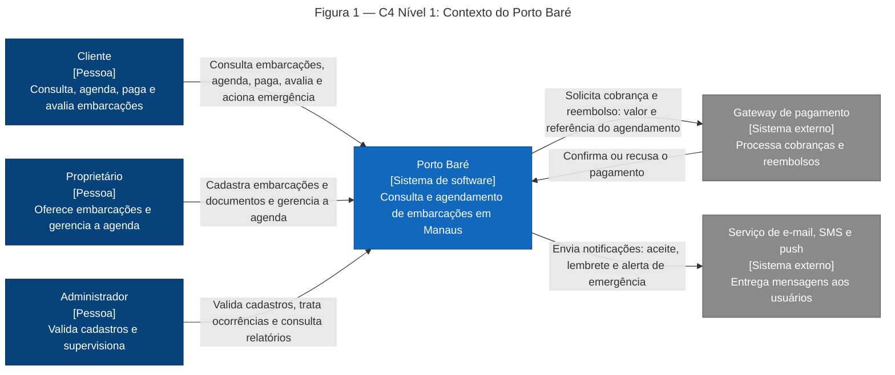
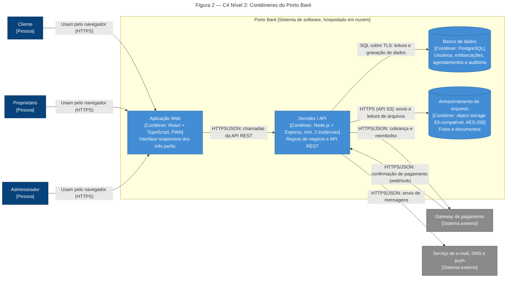
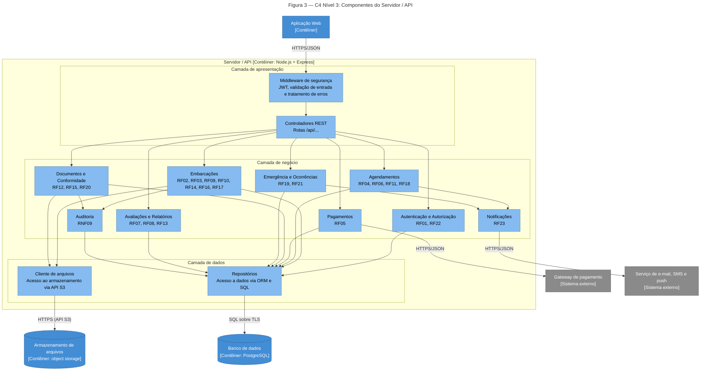
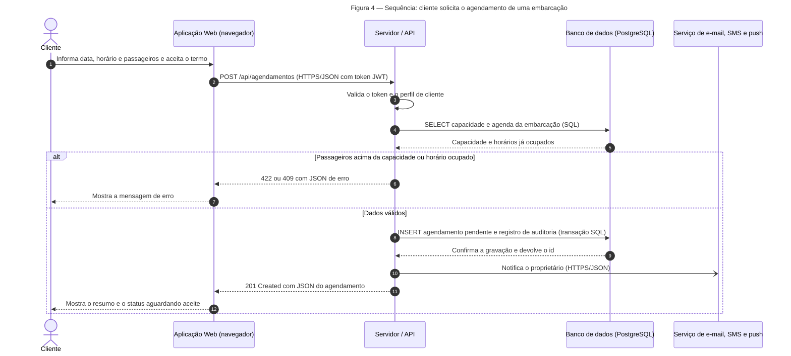

[README.md](https://github.com/user-attachments/files/34503736/README.md)

# Porto Baré — Requisitos e Arquitetura

| Campo | Informação |
|---|---|
| **Instituição** | Centro Universitário de Ensino Superior do Amazonas (CIESA) |
| **Curso** | Análise e Desenvolvimento de Sistemas (ADS) |
| **Disciplina** | Projetos de Sistemas |
| **Trabalho** | Requisitos e Arquitetura de um Sistema (entrega individual) |
| **Aluno** | José Lima da Mota Neto |
| **Sistema** | Porto Baré — consulta e agendamento de embarcações |
| **Versão** | 2.0 — Trabalho completo (Parte 1 e Parte 2) — novembro de 2026 |

Este documento reúne todo o conteúdo do trabalho. A **Parte 1** levanta e classifica os requisitos do sistema. A **Parte 2** projeta a arquitetura cliente-servidor que atende a esses requisitos. Regra central: toda decisão de arquitetura da Parte 2 é rastreável a um requisito da Parte 1 (seção [2.4](#24-rastreabilidade)).

---

## Sumário

- [Parte 1: Requisitos](#parte-1-requisitos)
  - [1.1 Introdução e convenções](#11-introdução-e-convenções)
  - [1.2 Descrição do sistema](#12-descrição-do-sistema)
  - [1.3 Requisitos funcionais (RF)](#13-requisitos-funcionais-rf)
  - [1.4 Requisitos não funcionais (RNF)](#14-requisitos-não-funcionais-rnf)
  - [1.5 Regras de negócio (RN)](#15-regras-de-negócio-rn)
  - [1.6 Visão consolidada e conformidade](#16-visão-consolidada-e-conformidade)
- [Parte 2: Documento de arquitetura](#parte-2-documento-de-arquitetura)
  - [2.1 Diagramas C4 (níveis 1 a 3)](#21-diagramas-c4-níveis-1-a-3)
  - [2.2 Registros de decisão (ADRs)](#22-registros-de-decisão-adrs)
  - [2.3 Comunicação cliente-servidor](#23-comunicação-cliente-servidor)
  - [2.4 Rastreabilidade](#24-rastreabilidade)
  - [2.5 Conformidade com o enunciado (Parte 2)](#25-conformidade-com-o-enunciado-parte-2)

---

# Parte 1: Requisitos

## 1.1 Introdução e convenções

Esta parte apresenta o negócio e o levantamento de requisitos do **Porto Baré**, sistema fictício de consulta e agendamento de embarcações em Manaus. O foco é conceitual: não há programação, e o objetivo é classificar corretamente os requisitos em três tipos.

| Tipo | Código | O que descreve |
|---|---|---|
| Requisito funcional | RF01, RF02… | O que o sistema **faz** para cada usuário. |
| Requisito não funcional | RNF01, RNF02… | **Como** o sistema se comporta (desempenho, segurança, etc.), sempre com uma medida verificável. |
| Regra de negócio | RN01, RN02… | Regra do negócio que **valeria mesmo sem o sistema** (lei, norma ou política da empresa). |

**Prioridades:** *Alta* é o requisito essencial ao funcionamento ou à segurança das pessoas, *Média* é importante mas o sistema opera sem ele por um período, e *Baixa* é desejável e pode ser entregue depois.

---

## 1.2 Descrição do sistema

O **Porto Baré** é uma aplicação web responsiva, acessível por computador e celular, que reúne em um só lugar a oferta de embarcações de Manaus (barcos, lanchas, jet skis, balsas, voadeiras e outras) para passeio, aluguel ou transporte fluvial. Nele, **clientes** consultam as embarcações disponíveis, conferem a ficha técnica, a licença, o seguro e a garantia, agendam e pagam o serviço; **proprietários** (pessoas físicas ou empresas náuticas) cadastram suas embarcações, controlam a agenda e respondem às solicitações; e o **administrador** valida a documentação, monitora vencimentos, trata ocorrências e acompanha os resultados. O sistema tem como princípio a **transparência** para os dois lados: o cliente contrata sabendo exatamente o que está contratando, e o proprietário mantém seus dados e documentos atualizados e rastreáveis.

### 1.2.1 Perfis de usuário

| Perfil | Quem é | Principais requisitos funcionais |
|---|---|---|
| Cliente | Pessoa que quer consultar, agendar e usar uma embarcação. | RF01 a RF08, RF17, RF18, RF19, RF21, RF23 |
| Proprietário | Pessoa física ou empresa náutica dona ou responsável pela embarcação. | RF09, RF10, RF11, RF14, RF15, RF16, RF21, RF22, RF23 |
| Administrador | Equipe interna do Porto Baré que valida e supervisiona. | RF12, RF13, RF20 |

### 1.2.2 Fluxo de negócio resumido

1. O proprietário se cadastra e registra a embarcação, com ficha técnica, documentos, licença e seguro.
2. O administrador confere a documentação e aprova ou rejeita o cadastro.
3. O cliente consulta as embarcações aprovadas, filtra e analisa a ficha completa.
4. O cliente solicita o agendamento e revê o resumo (preço, taxas, política de cancelamento, termo de responsabilidade).
5. O proprietário aceita ou recusa a solicitação; o cliente paga o agendamento aceito.
6. Ocorre o passeio, com acesso ao botão de emergência durante todo o trajeto.
7. O cliente avalia o serviço, e eventuais ocorrências ou reclamações são registradas e tratadas.

### 1.2.3 Escopo e premissas

**Dentro do escopo:** consulta, agendamento, pagamento, transparência de dados e documentos da embarcação, segurança e emergência, gestão e relatórios.

**Fora do escopo:** rastreamento contínuo da embarcação em tempo real, transporte de cargas e implementação de código.

**Premissas:**

- O Porto Baré atua como **plataforma intermediadora** entre clientes e proprietários, com atuação inicial em Manaus e região.
- O sistema é uma **aplicação web responsiva hospedada em provedor de nuvem** (decisão registrada no ADR-001, na Parte 2).
- O pagamento é feito por **gateway de pagamento externo**, e o sistema não armazena dados de cartão.
- Contas de administrador são criadas internamente pela equipe do Porto Baré.
- Exigências legais (documentação, habilitação, equipamentos de segurança) seguem as normas vigentes da Autoridade Marítima (Marinha do Brasil). O sistema registra e acompanha a validade dos documentos, mas não substitui a fiscalização oficial.
- Valores e prazos de políticas comerciais (como a do RN06) são definidos pelo Porto Baré e podem ser ajustados.

---

## 1.3 Requisitos funcionais (RF)

| Código | Usuário | Descrição | Prioridade |
|---|---|---|---|
| RF01 | Cliente | O sistema deve permitir que o cliente se cadastre e faça login. | Alta |
| RF02 | Cliente | O sistema deve permitir que o cliente consulte embarcações disponíveis filtrando por tipo, capacidade, data, preço e porto de saída. | Alta |
| RF03 | Cliente | O sistema deve permitir que o cliente visualize os detalhes de uma embarcação (fotos, capacidade, equipamentos de segurança e avaliações). | Média |
| RF04 | Cliente | O sistema deve permitir que o cliente agende uma embarcação informando data, horário e número de passageiros. | Alta |
| RF05 | Cliente | O sistema deve permitir que o cliente pague o agendamento online. | Alta |
| RF06 | Cliente | O sistema deve permitir que o cliente cancele ou reagende um agendamento. | Média |
| RF07 | Cliente | O sistema deve permitir que o cliente avalie a embarcação e o serviço após o passeio. | Baixa |
| RF08 | Cliente | O sistema deve permitir que o cliente consulte o histórico dos seus agendamentos. | Baixa |
| RF09 | Proprietário | O sistema deve permitir que o proprietário cadastre uma embarcação com tipo, capacidade, preço e fotos. | Alta |
| RF10 | Proprietário | O sistema deve permitir que o proprietário gerencie o calendário de disponibilidade das suas embarcações. | Alta |
| RF11 | Proprietário | O sistema deve permitir que o proprietário aceite ou recuse solicitações de agendamento. | Média |
| RF12 | Administrador | O sistema deve permitir que o administrador aprove ou rejeite o cadastro de embarcações após conferir a documentação. | Alta |
| RF13 | Administrador | O sistema deve permitir que o administrador gere relatórios de agendamentos e receitas por período. | Baixa |
| RF14 | Proprietário | O sistema deve permitir que o proprietário registre a ficha técnica da embarcação: nome, marca, modelo, ano de fabricação, motor (tipo, potência e quantidade), número de inscrição, capacidade e equipamentos de segurança (coletes, extintor, boias e kit de primeiros socorros). | Alta |
| RF15 | Proprietário | O sistema deve permitir que o proprietário informe seus dados (razão social ou nome, CNPJ ou CPF e contato) e envie a licença e os documentos da embarcação e a habilitação do condutor, com data de validade. | Alta |
| RF16 | Proprietário | O sistema deve permitir que o proprietário informe o seguro (seguradora, apólice, cobertura e validade) e as condições de garantia do serviço. | Alta |
| RF17 | Cliente | O sistema deve permitir que o cliente visualize a ficha técnica, a licença, o seguro e a garantia da embarcação antes de agendar. | Alta |
| RF18 | Cliente | O sistema deve permitir que o cliente veja, antes de confirmar o agendamento, o resumo com preço total, taxas, política de cancelamento e termo de responsabilidade, e registre o aceite. | Alta |
| RF19 | Cliente | O sistema deve permitir que o cliente acione um botão de emergência durante o passeio, que envia sua localização e exibe os contatos de emergência (Bombeiros 193, SAMU 192 e Marinha 185). | Alta |
| RF20 | Administrador | O sistema deve permitir que o administrador visualize as embarcações com documentos ou seguro vencidos ou a vencer e as suspenda. | Média |
| RF21 | Cliente e proprietário | O sistema deve permitir que o cliente ou o proprietário registre uma ocorrência ou reclamação de segurança sobre uma embarcação ou passeio. | Média |
| RF22 | Proprietário | O sistema deve permitir que o proprietário se cadastre e faça login. | Alta |
| RF23 | Cliente e proprietário | O sistema deve permitir que o cliente e o proprietário recebam notificações por e-mail ou aplicativo sobre solicitação, aceite, recusa, cancelamento e lembrete do passeio. | Média |

---

## 1.4 Requisitos não funcionais (RNF)

| Código | Categoria | Descrição | Medida | Prioridade |
|---|---|---|---|---|
| RNF01 | Desempenho | A consulta de embarcações com filtros deve retornar resultados em até 2 segundos para 95% das requisições, com até 500 usuários simultâneos. | 2 s, 95%, 500 usuários | Alta |
| RNF02 | Desempenho | O registro de uma solicitação de agendamento deve ser concluído em até 3 segundos no horário de pico. | 3 s | Alta |
| RNF03 | Desempenho | A página inicial deve carregar em até 4 segundos em conexão móvel 3G. | 4 s em 3G | Média |
| RNF04 | Segurança | 100% das comunicações entre cliente e servidor devem usar HTTPS (TLS 1.2 ou superior), e as senhas devem ser armazenadas com hash. | 100% HTTPS, TLS ≥ 1.2 | Alta |
| RNF05 | Segurança | O sistema deve tratar os dados pessoais conforme a LGPD (Lei 13.709/2018) e encerrar a sessão após 15 minutos de inatividade. | Lei 13.709/2018, 15 min | Alta |
| RNF06 | Disponibilidade | O sistema deve ter disponibilidade mínima de 99% ao mês (no máximo cerca de 7 horas de indisponibilidade em 30 dias). | 99% ao mês | Alta |
| RNF07 | Usabilidade e acessibilidade | Um usuário novo deve concluir um agendamento em até 5 minutos, sem treinamento, e as telas devem seguir o nível AA da WCAG 2.1. | 5 min, WCAG 2.1 AA | Média |
| RNF08 | Compatibilidade | O sistema deve funcionar nas 2 últimas versões do Chrome, Firefox, Edge e Safari e em telas a partir de 360 px de largura. | 2 versões, 4 navegadores, 360 px | Média |
| RNF09 | Segurança | O sistema deve registrar em log de auditoria 100% das alterações em dados de embarcação, documentos e seguro, com data, hora e usuário, mantendo o histórico por no mínimo 12 meses. | 100%, 12 meses | Média |
| RNF10 | Desempenho | O alerta de emergência deve ser enviado, com a localização, em até 5 segundos após o acionamento do botão. | 5 s | Alta |
| RNF11 | Usabilidade e acessibilidade | A ficha da embarcação e o botão de emergência devem estar acessíveis em até 2 toques a partir de qualquer tela. | 2 toques | Média |
| RNF12 | Segurança | Os documentos enviados (licença, apólice, habilitação) devem ser armazenados criptografados (AES-256) e acessíveis apenas ao próprio usuário e ao administrador. | AES-256 | Alta |

---

## 1.5 Regras de negócio (RN)

| Código | Tema | Descrição | Prioridade |
|---|---|---|---|
| RN01 | Documentação | Toda embarcação só pode operar com a documentação regularizada junto à Autoridade Marítima (Marinha do Brasil). | Alta |
| RN02 | Capacidade | O número de passageiros não pode exceder a capacidade máxima da embarcação. | Alta |
| RN03 | Segurança | Todo passageiro deve usar colete salva-vidas, e a embarcação deve ter um colete para cada ocupante. | Alta |
| RN04 | Habilitação | O jet ski só pode ser conduzido por pessoa habilitada pela Marinha. | Alta |
| RN05 | Menores | Menores de 18 anos só podem embarcar acompanhados de um responsável. | Média |
| RN06 | Cancelamento | Cancelamentos feitos com 24 horas ou mais de antecedência têm reembolso integral. Depois disso, retém-se 30% do valor. | Média |
| RN07 | Clima | Passeios podem ser suspensos em caso de condições climáticas adversas (tempestade, vento forte), com remarcação sem custo. | Média |
| RN08 | Seguro | Toda embarcação só pode ser oferecida ao público com seguro vigente que cubra os passageiros. | Alta |
| RN09 | Responsabilidade | O proprietário é responsável pela segurança dos passageiros, pela condição da embarcação e pela condução durante todo o passeio. | Alta |
| RN10 | Equipamentos | A embarcação deve manter em condições de uso os equipamentos obrigatórios de segurança (extintor, boias, sinalização e kit de primeiros socorros) e a vistoria em dia. | Alta |
| RN11 | Informação | O fornecedor deve informar de forma clara e verdadeira as características, o preço e os riscos do serviço (direito à informação do Código de Defesa do Consumidor). | Alta |
| RN12 | Emergência | Em caso de acidente ou emergência, o condutor deve prestar socorro e comunicar o fato à Autoridade Marítima. | Alta |
| RN13 | Garantia | Se o passeio não ocorrer por pane ou defeito da embarcação, o cliente tem direito a remarcação ou reembolso proporcional. | Média |

---

## 1.6 Visão consolidada e conformidade

### 1.6.1 Resumo quantitativo

| Tipo | Mínimo exigido | Entregue | Alta | Média | Baixa |
|---|---|---|---|---|---|
| Requisitos funcionais (RF) | 10 | 23 | 14 | 6 | 3 |
| Requisitos não funcionais (RNF) | 6 | 12 | 7 | 5 | 0 |
| Regras de negócio (RN) | 5 | 13 | 9 | 4 | 0 |
| **Total** | | **48** | **30** | **15** | **3** |

### 1.6.2 Cobertura das categorias de RNF

| Categoria | Requisitos |
|---|---|
| Desempenho | RNF01, RNF02, RNF03, RNF10 |
| Segurança | RNF04, RNF05, RNF09, RNF12 |
| Disponibilidade | RNF06 |
| Usabilidade e acessibilidade | RNF07, RNF11 |
| Compatibilidade | RNF08 |

Todas as 5 categorias previstas no enunciado estão cobertas (mínimo exigido: 4).

### 1.6.3 Conformidade com o enunciado (Parte 1)

| Entregável | Exigência | Situação | Seção |
|---|---|---|---|
| Descrição do sistema | Parágrafo sobre o negócio e os tipos de usuário | Atendido | 1.2 |
| Requisitos funcionais | Mínimo de 10, no formato "O sistema deve permitir que [usuário] [ação]" | 23, todos no formato | 1.3 |
| Requisitos não funcionais | Mínimo de 6, mensuráveis, em ao menos 4 categorias | 12, todos com medida, 5 categorias | 1.4 e 1.6.2 |
| Regras de negócio | Mínimo de 5, válidas mesmo sem o sistema | 13 | 1.5 |
| Tabela de requisitos | Código, descrição e prioridade em cada requisito | Atendido (com usuário, categoria ou tema como apoio) | 1.3, 1.4 e 1.5 |

---

# Parte 2: Documento de arquitetura

A arquitetura do Porto Baré é **cliente-servidor em três camadas** (apresentação, negócio e dados): uma aplicação web no navegador do usuário conversa por HTTPS com um servidor/API, que mantém os dados em um banco relacional e os documentos em um armazenamento de arquivos criptografado. Cada decisão abaixo aponta para os requisitos da Parte 1.

## 2.1 Diagramas C4 (níveis 1 a 3)

A arquitetura é descrita em três níveis de abstração do modelo C4. Todos os diagramas são feitos em Mermaid, têm título e legenda, e **os níveis não se misturam**: o nível 1 mostra só o sistema como uma caixa; o nível 2 mostra as partes que rodam separadas; o nível 3 mostra o interior de um contêiner, o servidor.

> **Nota sobre tecnologias:** as escolhas entre aplicação web ou app, entre banco relacional ou não relacional e entre sessão ou token estão justificadas nos ADRs (seção 2.2). As demais tecnologias (React, Node.js, object storage) foram adotadas por serem de uso amplo e podem ser trocadas sem alterar a estrutura da arquitetura.

### Nível 1: Contexto



**Legenda da Figura 1**

| Elemento | Significado |
|---|---|
| Caixa azul-escura | Pessoa: tipo de usuário do sistema (os três perfis da Parte 1) |
| Caixa azul | O sistema Porto Baré, representado como uma única caixa |
| Caixa cinza | Sistema externo com o qual o Porto Baré conversa |
| Seta | Sentido do fluxo; o texto da seta diz o que trafega |

### Nível 2: Contêineres



**Legenda da Figura 2**

| Elemento | Significado |
|---|---|
| Caixa azul-escura | Pessoa (usuário do sistema) |
| Caixa azul | Contêiner: parte do sistema que roda separada, com a tecnologia entre colchetes |
| Cilindro azul | Contêiner de armazenamento de dados (banco ou arquivos) |
| Moldura | Fronteira do sistema Porto Baré |
| Caixa cinza | Sistema externo |
| Seta | Sentido do fluxo; o texto traz o **protocolo** e a finalidade |

### Nível 3: Componentes do servidor / API



**Legenda da Figura 3**

| Elemento | Significado |
|---|---|
| Moldura grande | O contêiner Servidor / API, cujo interior está sendo detalhado |
| Molduras internas | As três camadas do servidor: apresentação, negócio e dados |
| Caixa azul-clara | Componente (módulo interno) do servidor, com os requisitos que atende |
| Caixa azul / cilindro | Outros contêineres do nível 2, mostrados só como vizinhos |
| Caixa cinza | Sistema externo |
| Seta | Dependência ou chamada; as setas que saem do servidor trazem o protocolo |

**Responsabilidade de cada componente**

| Componente | Camada | Responsabilidade | Requisitos |
|---|---|---|---|
| Middleware de segurança | Apresentação | Valida o token JWT e o perfil, valida a entrada e padroniza os erros (4xx e 5xx) | RNF04, RNF05 |
| Controladores REST | Apresentação | Expõem as rotas da API e encaminham cada chamada ao módulo de negócio | Todos os RF |
| Autenticação e Autorização | Negócio | Cadastro, login, emissão e renovação de tokens, controle por perfil | RF01, RF22, RNF05 |
| Embarcações | Negócio | Cadastro, ficha técnica, seguro, garantia, calendário e consulta com filtros | RF02, RF03, RF09, RF10, RF14, RF16, RF17, RN02 |
| Agendamentos | Negócio | Solicitação, aceite, reagendamento e cancelamento; valida capacidade, disponibilidade e política de cancelamento | RF04, RF06, RF11, RF18, RN02, RN06 |
| Pagamentos | Negócio | Cobrança e reembolso pelo gateway externo, e recepção da confirmação | RF05, RN06, RN13 |
| Documentos e Conformidade | Negócio | Recebe documentos, apoia a aprovação, controla vencimentos e suspensões | RF12, RF15, RF20, RN01, RN08 |
| Emergência e Ocorrências | Negócio | Alerta de emergência com localização, contatos e registro de ocorrências | RF19, RF21, RN12, RNF10 |
| Avaliações e Relatórios | Negócio | Avaliações, histórico do cliente e relatórios do administrador | RF07, RF08, RF13 |
| Notificações | Negócio | Monta e envia mensagens pelo serviço externo | RF23, RNF10 |
| Auditoria | Negócio | Registra data, hora e usuário de cada alteração em embarcação, documento e seguro | RNF09 |
| Repositórios | Dados | Única porta de acesso ao banco, com transações | RNF01, RNF02 |
| Cliente de arquivos | Dados | Envia e lê fotos e documentos no armazenamento criptografado | RNF12 |

---

## 2.2 Registros de decisão (ADRs)

Os três ADRs abaixo registram decisões reais do sistema, no modelo do Anexo A do enunciado. Cada um aponta para os requisitos que o exigem, compara ao menos duas alternativas reais e declara consequências negativas.

### ADR-001 — Adotar aplicação web responsiva (PWA) como cliente do sistema

**Status:** aceita  
**Data:** 2026-11-06

**Contexto**

Os requisitos **RNF08** (navegadores e telas a partir de 360 px), **RNF03** (página inicial em 4 s em 3G), **RNF07** (agendar em 5 minutos sem treinamento), **RNF11** (acesso em 2 toques) e **RF19** (botão de emergência) exigem um cliente que funcione em celulares comuns, carregue rápido em redes móveis lentas, como as de passeios fluviais, e seja usado também pelo administrador no computador.

**Alternativas consideradas**

*Alternativa A — Aplicação web responsiva (PWA)*  
A favor: um único código serve computador e celular (RNF08); não exige instalação por loja, o que facilita o primeiro acesso (RNF07); o cache do navegador (service worker) reduz o tempo de carregamento (RNF03).  
Contra: acesso limitado a recursos do aparelho, como notificações push em alguns dispositivos e localização em segundo plano; depende de conexão com a internet.

*Alternativa B — Aplicativo nativo (Android e iOS)*  
A favor: acesso completo a GPS e notificações; funcionamento parcial sem internet; presença nas lojas de aplicativos.  
Contra: exige códigos separados para cada sistema (ou um framework adicional), instalação e publicação em lojas, com mais custo e prazo; o administrador ainda precisaria de uma versão web, então haveria dois clientes para manter.

**Decisão**

Escolhemos **A (PWA)**, porque atende RNF08 e RNF03 com um único código e permite que cliente, proprietário e administrador usem o sistema pelo mesmo endereço, sem instalar nada (RNF07).

**Consequências**

*Positivas:* menor custo e prazo de desenvolvimento; atualizações imediatas para todos os usuários; um único conjunto de testes de compatibilidade.  
*Negativas:* o alerta de emergência (RF19, RNF10) depende de conexão, o que é um risco em trechos de rio sem sinal; como mitigação, os contatos de emergência ficam em cache para consulta sem internet. As notificações push podem não funcionar em todos os aparelhos, então e-mail e SMS ficam como alternativa (RF23).

### ADR-002 — Adotar PostgreSQL (banco relacional) como banco de dados principal

**Status:** aceita  
**Data:** 2026-11-06

**Contexto**

**RF04**, **RF10** e **RN02** exigem que um agendamento nunca ocupe o mesmo horário de outro nem exceda a capacidade da embarcação. **RNF02** (registro em até 3 s), **RNF01** (consulta com filtros em até 2 s para 500 usuários simultâneos) e **RNF09** (auditoria de 100% das alterações) pedem consistência transacional e consultas eficientes.

**Alternativas consideradas**

*Alternativa A — PostgreSQL (relacional)*  
A favor: transações ACID, que gravam o agendamento e o registro de auditoria juntos; restrições de integridade (chaves estrangeiras e restrição de exclusão por intervalo de tempo) que impedem agendamentos sobrepostos no próprio banco; índices para consultas com filtros (RNF01); relatórios por SQL (RF13).  
Contra: escala horizontal de escrita mais difícil; esquema rígido, que exige migrações a cada mudança.

*Alternativa B — MongoDB (não relacional, orientado a documentos)*  
A favor: esquema flexível para fichas de embarcações com atributos diferentes por tipo (jet ski, balsa, lancha); escala horizontal mais simples.  
Contra: evitar sobreposição de horários exige lógica extra na aplicação, sujeita a falhas em acessos simultâneos; as relações entre cliente, agendamento, embarcação e pagamento são naturalmente relacionais e ficam mais trabalhosas em documentos.

**Decisão**

Escolhemos **A (PostgreSQL)**, porque a regra mais crítica do negócio, nunca vender duas vezes o mesmo horário (RN02, RF04), passa a ser garantida pelo próprio banco, e porque a auditoria de 100% das alterações (RNF09) entra na mesma transação.

**Consequências**

*Positivas:* integridade dos agendamentos garantida pelo banco; consultas e relatórios simples; auditoria consistente.  
*Negativas:* atributos específicos de cada tipo de embarcação exigem modelagem cuidadosa (colunas opcionais ou tabela de atributos); crescimento muito acima do previsto exigirá réplicas de leitura ou particionamento; cada mudança de esquema exige uma migração planejada.

### ADR-003 — Autenticar usuários com token JWT de curta duração

**Status:** aceita  
**Data:** 2026-11-06

**Contexto**

**RNF05** (sessão encerrada após 15 minutos de inatividade), **RNF04** (comunicação segura), **RNF06** (disponibilidade de 99% com ao menos 2 instâncias da API) e **RF01** e **RF22** (login de cliente e proprietário) exigem identificar o usuário a cada requisição sem depender de uma instância específica do servidor.

**Alternativas consideradas**

*Alternativa A — Token JWT de curta duração (com renovação)*  
A favor: a API não guarda estado, então qualquer instância valida o token (RNF06); a validade de 15 minutos fica embutida no token (RNF05); combina bem com uma aplicação web e uma API REST.  
Contra: revogar um token antes de expirar (por exemplo, quando o administrador suspende um usuário) exige uma lista de revogação; um token roubado vale até expirar; o fluxo de renovação é mais complexo.

*Alternativa B — Sessão no servidor (cookie + armazenamento compartilhado de sessões)*  
A favor: encerra a sessão imediatamente; expiração por inatividade nativa; menos informação guardada no cliente.  
Contra: com várias instâncias, exige um armazenamento de sessões compartilhado (mais um componente para manter, que vira ponto único de falha e pesa em RNF06).

**Decisão**

Escolhemos **A (JWT)**, porque com 2 ou mais instâncias (RNF06) a API fica sem estado, e a validade de 15 minutos, renovada automaticamente enquanto o usuário estiver ativo, atende ao RNF05.

**Consequências**

*Positivas:* a API escala sem sessão compartilhada; a expiração por inatividade segue o padrão do token; menos consultas ao banco por requisição.  
*Negativas:* suspender um usuário exige consultar uma lista de revogação a cada renovação; um token comprometido continua válido por até 15 minutos; a aplicação web precisa tratar renovação e expiração do token.

---

## 2.3 Comunicação cliente-servidor

### 2.3.1 Fluxo de requisição e resposta

Caso de uso completo: **o cliente solicita o agendamento de uma embarcação (RF04)**, percorrendo cliente, servidor, banco e resposta.



**Legenda da Figura 4**

| Elemento | Significado |
|---|---|
| Boneco e retângulos no topo | Participantes: o cliente e as partes do sistema (nível 2 do C4) mais o serviço externo |
| Seta cheia | Requisição ou chamada, com o protocolo ou método entre parênteses |
| Seta tracejada | Resposta |
| Seta com ponta aberta | Mensagem assíncrona (não espera resposta) |
| Bloco alt | Caminhos alternativos: erro ou sucesso |
| Números | Ordem dos passos |

### 2.3.2 Requisições HTTP

Quatro requisições da API do Porto Baré, com método, URL, status e JSON. Todas usam HTTPS e trocam JSON (`Content-Type: application/json`). A requisição 3 é o caso de erro (4xx).

| Nº | Método | URL | Status | RF |
|---|---|---|---|---|
| 1 | GET | `/api/embarcacoes?tipo=lancha&data=2026-12-20&capacidade=6` | 200 OK | RF02 |
| 2 | POST | `/api/agendamentos` | 201 Created | RF04 |
| 3 | PUT | `/api/agendamentos/1045` | 409 Conflict (erro) | RF06 |
| 4 | DELETE | `/api/agendamentos/1038` | 200 OK | RF06 |

**Requisição 1: consultar embarcações disponíveis (GET, RF02).** O GET apenas lê dados e não altera nada.

```http
GET /api/embarcacoes?tipo=lancha&data=2026-12-20&capacidade=6 HTTP/1.1
Host: api.portobare.example
Accept: application/json
```

Resposta: `200 OK`

```json
{
  "total": 2,
  "embarcacoes": [
    {
      "id": 12,
      "nome": "Lancha Iara",
      "tipo": "lancha",
      "marca": "Fibrafort",
      "ano": 2019,
      "capacidade": 8,
      "preco_hora": 350.00,
      "porto": "Ponta Negra",
      "seguro_vigente": true,
      "nota_media": 4.8
    },
    {
      "id": 27,
      "nome": "Lancha Boto Rosa",
      "tipo": "lancha",
      "marca": "Focker",
      "ano": 2021,
      "capacidade": 10,
      "preco_hora": 480.00,
      "porto": "Tupé",
      "seguro_vigente": true,
      "nota_media": 4.6
    }
  ]
}
```

**Requisição 2: solicitar um agendamento (POST, RF04).** O POST cria um novo registro.

```http
POST /api/agendamentos HTTP/1.1
Host: api.portobare.example
Authorization: Bearer <token JWT do cliente>
Content-Type: application/json
```

```json
{
  "embarcacao_id": 12,
  "data": "2026-12-20",
  "hora_inicio": "09:00",
  "duracao_horas": 4,
  "passageiros": 6,
  "aceite_termo": true
}
```

Resposta: `201 Created` (com o cabeçalho `Location: /api/agendamentos/1045`)

```json
{
  "id": 1045,
  "embarcacao_id": 12,
  "cliente_id": 87,
  "data": "2026-12-20",
  "hora_inicio": "09:00",
  "duracao_horas": 4,
  "passageiros": 6,
  "valor_embarcacao": 1400.00,
  "taxa_servico": 70.00,
  "valor_total": 1470.00,
  "status": "pendente_aceite",
  "criado_em": "2026-11-06T14:32:10-04:00"
}
```

**Requisição 3: reagendar para um horário já ocupado (PUT, RF06, erro 4xx).** O PUT substitui os dados do agendamento existente. Aqui o servidor recusa, porque a embarcação já tem agendamento confirmado no novo horário.

```http
PUT /api/agendamentos/1045 HTTP/1.1
Host: api.portobare.example
Authorization: Bearer <token JWT do cliente>
Content-Type: application/json
```

```json
{
  "data": "2026-12-27",
  "hora_inicio": "09:00",
  "duracao_horas": 4,
  "passageiros": 6
}
```

Resposta: `409 Conflict`

```json
{
  "erro": "horario_indisponivel",
  "mensagem": "A embarcação já possui agendamento confirmado nesse horário.",
  "sugestoes": [
    {
      "data": "2026-12-27",
      "hora_inicio": "14:00"
    }
  ]
}
```

**Requisição 4: cancelar um agendamento pago (DELETE, RF06).** O DELETE cancela o agendamento e devolve o cálculo do reembolso conforme a RN06.

```http
DELETE /api/agendamentos/1038 HTTP/1.1
Host: api.portobare.example
Authorization: Bearer <token JWT do cliente>
Accept: application/json
```

Resposta: `200 OK`

```json
{
  "id": 1038,
  "status": "cancelado",
  "cancelado_em": "2026-11-06T15:10:42-04:00",
  "reembolso": {
    "percentual": 100,
    "valor": 1470.00,
    "motivo": "Cancelamento com 24 horas ou mais de antecedência"
  }
}
```

### 2.3.3 HTTPS

**Dados do sistema que precisam de proteção**

| Dado | Por que precisa de proteção | Requisito |
|---|---|---|
| E-mail, senha e token JWT | Quem os captura assume a conta do usuário | RNF04, RNF05 |
| Dados pessoais (nome, CPF ou CNPJ, contato) | São dados protegidos pela LGPD | RNF05 |
| Documentos (licença, apólice, habilitação) | Sensíveis; a exposição permite fraude e uso indevido | RNF12 |
| Dados do agendamento e valores | A alteração em trânsito poderia mudar preço, data ou passageiros | RNF04 |
| Localização enviada no alerta de emergência | Expõe a posição física do cliente | RNF10, RF19 |
| Dados de pagamento | Tratados pelo gateway externo; o Porto Baré não os armazena, e a comunicação com o gateway também é HTTPS | RNF04 |

**O que o TLS garante**

- **Confidencialidade:** os dados são criptografados entre o navegador e o servidor; quem estiver na mesma rede (por exemplo, um Wi-Fi público de porto ou marina) não consegue ler.
- **Integridade:** qualquer alteração dos dados no caminho é detectada.
- **Autenticidade do servidor:** o certificado confirma que o navegador está falando com o servidor do Porto Baré, e não com um site falso.

**Como será aplicado (RNF04):** TLS 1.2 ou superior em 100% das comunicações, redirecionamento automático de HTTP para HTTPS e cabeçalho HSTS. Entre o servidor e o banco, a conexão SQL também usa TLS (Figura 2).

**O que o TLS não garante:** a proteção dos dados armazenados (tratada pela criptografia AES-256 do RNF12), a autorização de quem pode ver o quê (tratada pelo módulo de Autenticação e Autorização) e a segurança de um aparelho já comprometido.

---

## 2.4 Rastreabilidade

### 2.4.1 Requisitos não funcionais para decisões

Cada RNF está ligado a uma decisão (ADR) ou a um elemento do C4. Nenhum RNF ficou sem decisão.

| RNF | Medida | Decisão ou elemento que atende | Como atende |
|---|---|---|---|
| RNF01 | Consulta em 2 s (95%), 500 usuários | ADR-002; C4 nível 3: Embarcações e Repositórios | Índices e consultas com filtros no PostgreSQL, acessadas pelo módulo de Embarcações |
| RNF02 | Registro de agendamento em 3 s | ADR-002; C4 nível 3: Agendamentos | Gravação do agendamento e da auditoria em uma única transação |
| RNF03 | Página inicial em 4 s no 3G | ADR-001 | PWA com cache do navegador e carregamento leve |
| RNF04 | 100% HTTPS (TLS ≥ 1.2) e senhas com hash | Seção 2.3.3; C4 nível 2 (todas as setas HTTPS ou TLS); C4 nível 3: Autenticação e Autorização | TLS em todas as comunicações; hash de senhas no módulo de autenticação |
| RNF05 | LGPD e sessão de 15 min | ADR-003; C4 nível 3: Middleware de segurança e Autenticação e Autorização | Token de 15 minutos renovado só com atividade; controle de acesso por perfil |
| RNF06 | Disponibilidade de 99% ao mês | ADR-003; C4 nível 2: Servidor / API com mín. 2 instâncias | API sem estado, replicável sem sessão compartilhada |
| RNF07 | Agendar em 5 min e WCAG 2.1 AA | ADR-001; C4 nível 2: Aplicação Web | Interface responsiva e acessível, sem instalação |
| RNF08 | 4 navegadores e telas de 360 px | ADR-001 | Aplicação web responsiva única |
| RNF09 | Auditoria de 100%, 12 meses | ADR-002; C4 nível 3: Auditoria | Registro de auditoria gravado na mesma transação da alteração |
| RNF10 | Alerta de emergência em 5 s | C4 nível 3: Emergência e Ocorrências e Notificações; C4 nível 2: seta para o serviço de mensagens | Fluxo direto, sem etapas intermediárias, até o serviço externo de envio |
| RNF11 | Acesso em 2 toques | ADR-001; C4 nível 2: Aplicação Web | Atalhos fixos para a ficha e para a emergência na interface |
| RNF12 | Documentos com AES-256 | C4 nível 2: Armazenamento de arquivos; C4 nível 3: Documentos e Cliente de arquivos | Criptografia em repouso no armazenamento e acesso restrito por perfil |

### 2.4.2 Requisições HTTP para requisitos funcionais

Cada requisição HTTP corresponde a um RF. Nenhuma ficou sem requisito.

| Requisição | Método e URL | RF correspondente | Regras relacionadas |
|---|---|---|---|
| 1 | GET `/api/embarcacoes?tipo=...` | RF02: consultar embarcações com filtros | RN11 (informação clara) |
| 2 | POST `/api/agendamentos` | RF04: agendar uma embarcação | RN02 (capacidade), RF18 (aceite do termo) |
| 3 | PUT `/api/agendamentos/1045` | RF06: reagendar um agendamento | RN07 (remarcação), RN02 |
| 4 | DELETE `/api/agendamentos/1038` | RF06: cancelar um agendamento | RN06 (reembolso) |

---

## 2.5 Conformidade com o enunciado (Parte 2)

| Entregável | Exigência | Situação | Seção |
|---|---|---|---|
| Diagrama de contexto (nível 1) | Todos os tipos de usuário e ao menos 2 sistemas externos; setas com legenda do que trafega; sem banco de dados | 3 perfis e 2 sistemas externos; sem banco | 2.1 (Figura 1) |
| Diagrama de contêineres (nível 2) | Cliente, servidor e banco; tecnologia em cada contêiner; protocolo em cada seta | 4 contêineres com tecnologia; todas as setas com protocolo | 2.1 (Figura 2) |
| Diagrama de componentes (nível 3) | Módulos do servidor, com camadas de apresentação, negócio e dados visíveis | 11 componentes em 3 camadas | 2.1 (Figura 3) |
| Regras dos diagramas | Título e legenda em todos; níveis não se misturam; tudo em Mermaid neste arquivo | Atendido | 2.1 e 2.3.1 |
| ADRs | 3, no modelo do Anexo A, com 2 alternativas reais e consequência negativa, ligados a requisitos | 3 ADRs completos | 2.2 |
| Fluxo de requisição e resposta | Diagrama de sequência de um caso de uso completo: cliente, servidor, banco e resposta | Atendido | 2.3.1 (Figura 4) |
| Requisições HTTP | 4, com método, URL, status e JSON, incluindo ao menos um erro 4xx | 4 requisições, com um 409 | 2.3.2 |
| HTTPS | Dados que precisam de proteção e o que o TLS garante | Atendido | 2.3.3 |
| Rastreabilidade | Cada RNF ligado a uma decisão; cada requisição HTTP ligada a um RF | 12 RNFs e 4 requisições, sem lacunas | 2.4 |
